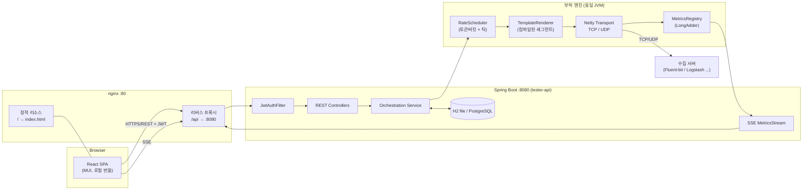
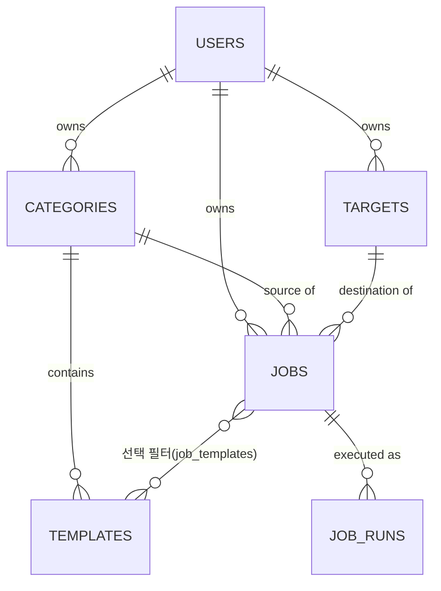
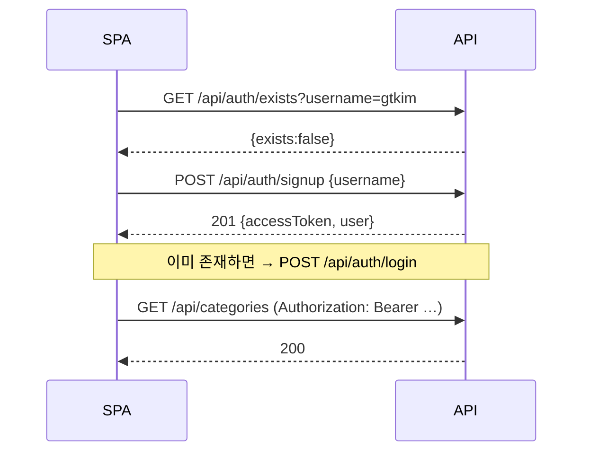
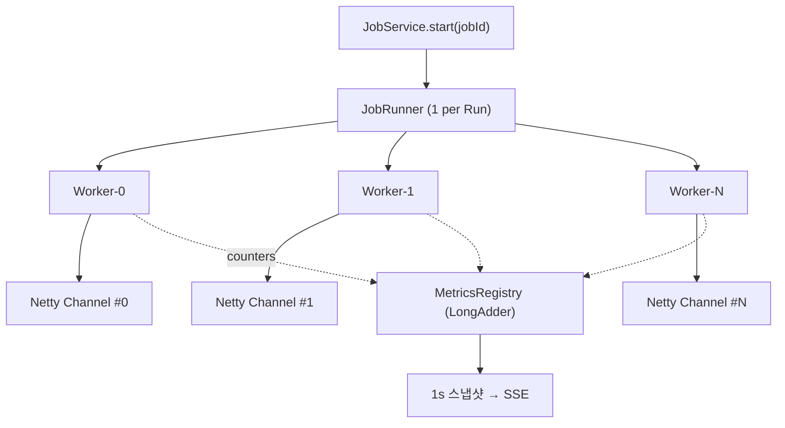

# 테스트 도구 (Test Tool) 설계 문서

- 문서 버전: v1.1
- 작성일: 2026-09-11 (최근 갱신: 2026-09-12)
- 프로젝트: `com.tms.tester`
- 상태: **구현 완료 + 운영 편의 기능 추가 진행 중**. §1~§14 는 **현재 구현 상태를 그대로 반영**하도록
  갱신했다(더 이상 "설계안"이 아니라 코드와 맞춘 참조 문서다). §15~§16 은 왜 그렇게
  됐는지의 결정 이력이다 — 현재 동작을 알고 싶으면 본문을, 왜 그런지 궁금하면 §16 을 본다.

---

## 0. 새 세션을 위한 빠른 시작

다른 세션(대화)에서 이 프로젝트를 이어받았다면 이 절만 읽고 바로 작업을 시작할 수 있게
만든 절이다. 상세는 각 절 본문과 §16(결정 이력)을 참고한다.

### 0.1 지금 뭐가 되어 있는가

- 로그인/가입, 카테고리·템플릿 CRUD, 전송 대상 CRUD, 전송 작업 시작/정지/실시간 모니터링까지
  **기능 전체가 동작한다.** TCP/UDP 10만 EPS 실측 검증 완료(§16.1). TLS 전송(§16.10),
  UTF-8/CP949/Base64 인코딩 선택(§16.6), Docker 배포(§16.8), 로컬 테스트용 수신 서버
  `tools/log-sink`(§16.9)까지 추가된 상태다. 프론트엔드는 Bootstrap 에서 **MUI 로 전면
  재작성**됐다(§16.11) — 화면 코드를 고치기 전에 그 절의 "MUI v9 에서 걸린 것"을 먼저 읽는 게 좋다.
- **완료가 아닌 것**: PostgreSQL 프로파일(§3, §5.3 — 설정 자리만 있고 실제 검증 안 됨),
  분산 부하 생성(§11.5 — 스키마 자리만 예약), Kafka 등 §11.1 표의 "추가 방법" 프로토콜들
  (SPI 는 있지만 구현체 없음 — TLS 는 §16.10 에서 구현됨), Prometheus 메트릭 노출(§13.3
  하단 참고 — 설정은 있지만 레지스트리 의존성이 빠져 있어 실제로는 동작하지 않음), UDP
  `SO_REUSEPORT`(§8.6 — 소켓 분산은 되지만 커널 레벨 로드밸런싱은 아직), UDP 오버사이즈
  카운터 노출(§8.6 — 내부 집계만 있고 API/화면에는 안 보임).

### 0.2 실행 / 테스트 명령

| 하고 싶은 일 | 명령 |
|---|---|
| 로컬 개발(백엔드+프론트 동시) | `./gradlew dev` → http://localhost:5173 |
| 백엔드만 | `./gradlew backend` (:8080) |
| 프론트만 | `./gradlew frontend` (:5173) |
| 기능 테스트 전체 | `./gradlew build` (타이밍 무관, 병렬 빌드에서도 안정적) |
| 성능 벤치마크 | `./gradlew perf` (반드시 단독 실행 — §16.7) |
| 전체 스택 Docker 배포 | `docker compose up -d --build` (루트) → 자세한 내용은 README.md "Docker 배포" 절 참고 |
| 로그 수신 테스트 서버 | `cd tools/log-sink && docker compose up -d --build` → http://localhost:8090 |

운영 관점 사용법(배포, 환경변수, 트러블슈팅)은 이 문서가 아니라 **README.md 가 1차 출처**다.
이 문서(design.md)는 "왜 이렇게 만들었나 / 내부 구조가 어떤가"를 다룬다.

### 0.3 기능별 핵심 파일 위치

| 기능 | 시작할 파일 |
|---|---|
| 새 플레이스홀더 함수 추가 | `tester-generator/.../generator/writers/StandardFunctions.java` (§6.4) |
| 새 전송 프로토콜 추가 | `tester-transport/.../transport/TransportFactory.java` 구현체 추가 (§11.2, 부록 A) |
| 새 로그 헤더 포맷 추가 | `tester-common/.../common/LogFormat.java` enum 값 추가 (§16.2 D5) |
| REST API 추가/수정 | `tester-api/.../<도메인>/*Controller.java`, `*Service.java`, `*Dtos.java` (§9) |
| 인증/JWT | `tester-api/.../security/JwtService.java`, `JwtAuthFilter.java` (§7) |
| 레이트 제어·배치·백프레셔 | `tester-transport/.../transport/GeneratorWorker.java` (§8.3~8.6) |
| 실행 오케스트레이션(시작/정지/자동재개) | `tester-api/.../job/RunManager.java`, `JobService.java` (§8.9) |
| 실시간 메트릭(SSE) | `tester-api/.../metrics/MetricsService.java`, `StreamController.java` (§7.2, §9.5) |
| 프론트 전송 콘솔 | `tester-frontend/src/pages/SendConsole.tsx` (§10) |
| 프론트 템플릿 스튜디오 | `tester-frontend/src/pages/Templates.tsx` (§10.3) |
| 프론트 테마·색·밀도 | `tester-frontend/src/theme.tsx` (§10.4, §16.11) |
| 프론트 공용 위젯(상태칩·지표·토스트·확인창) | `tester-frontend/src/components/common.tsx` (§16.11) |
| 시드 데이터(신규 가입 시 기본 카테고리/대상) | `tester-api/.../seed/SeedService.java` (부록 B) |
| Docker 이미지 | `tester-api/Dockerfile`, `tester-frontend/Dockerfile`, 루트 `docker-compose.yml` (§16.8) |
| 로그 수신 테스트 서버 | `tools/log-sink/LogSink.java` (§16.9) |

### 0.4 코드를 고치기 전에 알아야 할 습관 3가지

1. **엔진 핫패스(GeneratorWorker, ValueWriter 구현체, CompiledTemplate)에서는 절대
   String 연결/정규식/박싱을 새로 넣지 않는다.** §6.3·§8.3 이 그 이유다. 여기 코드를 고칠 땐
   `./gradlew perf` 로 회귀가 없는지 반드시 확인한다.
2. **공용 enum(Framing/LogFormat/Protocol/WireEncoding/SelectionStrategy/OverflowPolicy/
   RunState)은 `tester-common` 에 있다.** transport 나 domain 에 새 enum 을 추가하고 싶어도,
   양쪽에서 다 참조해야 하는 값이면 common 에 둔다(§16.2 D1 에 이걸 몰라서 겪은 실수가 있다).
3. **문서(README.md, docs/design.md)와 실제 코드가 어긋나면 반드시 이 문서도 같이 고친다.**
   이번 갱신 자체가 "코드는 여러 번 바뀌었는데 문서 본문은 최초 설계안 그대로 남아있던" 것을
   바로잡은 작업이었다 — 같은 일이 반복되지 않게, 동작을 바꾸는 커밋에는 관련 절 갱신을 포함한다.

---

## 1. 개요

### 1.1 목적
로그 수집 파이프라인(Fluent-bit, Logstash, Kafka, OpenSearch 등)의 **부하/기능 테스트**를 위해,
사용자가 정의한 로그 템플릿으로부터 실시간 로그를 생성하여 지정한 서버로 TCP/UDP 전송하는 웹 애플리케이션.

### 1.2 핵심 목표
| # | 목표 | 수용 기준 |
|---|------|-----------|
| G1 | 아이디만으로 가입/로그인 | 비밀번호 없음, 중복 확인만 수행 |
| G2 | SPA 웹 UI | React + nginx 배포, 폐쇄망(오프라인) 동작 |
| G3 | REST + JWT | 모든 API 호출에 JWT 인증/인가 |
| G4 | 카테고리 기반 로그 템플릿 | 카테고리 1 : N 로그 타입, 런타임 수정 즉시 반영 |
| G5 | 랜덤 값 치환 | IP / 숫자 / 문자열 / 시각 / 선택지 등 |
| G6 | **초당 10만 건 이상 전송** | 단일 노드, 평균 200B 로그 기준 지속 100k EPS |
| G7 | 실시간 전송 상태 제공 | 1초 주기 EPS / 누적건수 / 에러 / 대역폭 |
| G8 | 영속화 | 재시작 후 템플릿·대상·작업 설정 유지 |
| G9 | 확장성 | 전송 프로토콜 / 랜덤 생성기 / 로그 포맷을 플러그인으로 추가 |

### 1.3 비목표 (Non-goals)
- 실제 인증 보안(비밀번호, SSO, 감사추적) — **폐쇄망 내부 도구 전제**
- 전송된 로그의 수신/검증(수신측은 테스트 대상). 단, 검증용 경량 sink 툴은 별도 제공(§12.3)
- 멀티 노드 분산 부하 생성 (v2 확장 포인트로만 설계, §11.5)

### 1.4 용어
| 용어 | 설명 |
|------|------|
| **Category** | 로그의 큰 분류. 예: `tomcat`, `nginx`, `apache`, `firewall` |
| **Template (LogType)** | 카테고리에 속한 개별 로그 종류. 예: `tomcat-access`, `tomcat-catalina-error` |
| **Placeholder** | 템플릿 내 랜덤 치환 구문. 예: `${ip}`, `${int(1,100)}` |
| **Target** | 전송 대상 서버. host/port/protocol 묶음 |
| **Job** | "어떤 카테고리를, 어디로, 초당 몇 건" 전송 설정 (영속) |
| **Run** | Job의 1회 실행 인스턴스 (실행 이력) |
| **EPS** | Events Per Second, 초당 전송 건수 |

---

## 2. 전체 아키텍처



### 2.1 배포 토폴로지
- **1 노드 기본**: nginx(정적+프록시) + Spring Boot(API+엔진) + 임베디드 DB
- 부하 엔진을 API와 **같은 JVM**에 두는 이유: 10만 EPS 구간에서 프로세스 간 전달 비용/직렬화 비용 제거. 대신 엔진 스레드는 톰캣 워커와 분리된 전용 스레드풀로 격리(§8.4).
- v2에서 엔진만 별도 노드로 분리 가능하도록 `transport` 모듈은 Spring 비의존으로 설계(§11).

---

## 3. 기술 스택 및 결정 사항

| 영역 | 선택 | 근거 |
|------|------|------|
| 언어/런타임 | **Java 21 (LTS)** | 로컬 JDK 가 Corretto 21. toolchain 을 25 → 21 로 하향 확정 |
| 프레임워크 | Spring Boot 4.1.1 (기존 유지) | 스캐폴드 재사용 |
| 웹 | Spring MVC (Servlet, Virtual Thread 활성화) | 관리 API는 저부하. 부하 엔진은 Netty 별도 |
| 전송 | **Netty 4.2** (`NioEventLoopGroup`, Linux는 `Epoll`) | 풀드 다이렉트 버퍼, zero-copy write (`SO_REUSEPORT`는 검토했지만 아직 안 씀 — §8.6) |
| 보안 | Spring Security + JJWT(HS256) | |
| 영속 | Spring Data JPA (`ddl-auto=update`) | `h2`(file) 기본 / `postgres` 프로파일 전환. Flyway 는 미도입(§16 D2) |
| 프론트 | React 18.3 + Vite + TypeScript | |
| UI | **MUI v9 (Material UI) + MUI Icons (npm 번들, CDN 미사용)** | 폐쇄망 요구사항. Bootstrap 5 에서 전환(§16.11) |
| 상태관리 | React Context + 훅 | 화면 4개(§10.1) 규모에 외부 상태 라이브러리는 과하다(§16 D3 — 결정 당시엔 대시보드가 있어 5개였다) |
| 차트 | MUI X Charts v9 (MIT 커뮤니티 버전, npm 번들) | 실시간 EPS 그래프. Recharts 에서 전환(§16.11) |
| 빌드 | Gradle 멀티모듈 + 시스템 `npm` 직접 호출(Exec 태스크) | `./gradlew build` 한 번에 FE/BE 산출물. node-gradle 플러그인은 안 씀(아래 §10.5) |

---

## 4. 멀티모듈 구조

```
tester/
├── settings.gradle                  # include 선언 (Gradle 모듈은 6개 — frontend 포함)
├── build.gradle                     # 공통 subprojects 설정 + dev/backend/frontend/perf 태스크
├── gradle.properties                # org.gradle.parallel=true (dev 태스크가 필요로 한다)
├── docker-compose.yml               # 전체 스택(백엔드+프론트) 배포용 — §16.8
├── .env.example                     # docker-compose 가 읽는 환경변수 템플릿
├── .dockerignore
├── deploy/nginx.conf                # 컨테이너 없이 직접 설치할 때 쓰는 nginx 설정
├── docs/design.md                   # 이 문서
├── tester-common/                   # 공용 enum/예외 (Framing, LogFormat, Protocol, WireEncoding,
│                                    #   SelectionStrategy, OverflowPolicy, RunState). 의존성 없음
├── tester-domain/                   # JPA 엔티티, Repository (Hibernate ddl-auto — Flyway 미사용, §16.2 D2)
├── tester-generator/                # 템플릿 파서/컴파일러/렌더러, 값 생성기 SPI
│                                    #   └ 의존: tester-common, netty-buffer 만 (Spring 비의존)
├── tester-transport/                # Netty TCP/UDP 송신기, 레이트 제어, 메트릭
│                                    #   └ 의존: tester-generator, netty-transport (Spring 비의존)
├── tester-api/                      # Spring Boot 애플리케이션 (bootJar) + Dockerfile
│                                    #   REST, Security/JWT, 오케스트레이션, SSE, 시드 데이터
├── tester-frontend/                 # React SPA (Vite) + Dockerfile + nginx.conf(Docker용)
│                                    #   build 결과 dist/, Gradle 태스크로도 빌드(§10.5)
└── tools/log-sink/                  # 로컬 테스트용 로그 수신 서버. 순수 JDK 단일 파일, Gradle 미편입(§16.9)
    ├── LogSink.java
    ├── Dockerfile
    └── docker-compose.yml
```

### 4.1 모듈 의존 방향
```
common ← domain ← api
common ← generator ← transport ← api
frontend (독립, 산출물만 소비. api 와는 REST/SSE 로만 통신)
tools/log-sink (완전히 독립. Gradle 빌드에 속하지 않는다)
```
- `generator` / `transport`는 **Spring에 의존하지 않는 순수 라이브러리**. → 단독 CLI 부하기, 다른 노드 분산 실행, 벤치마크에 그대로 재사용(현재는 JMH 가 아니라 `@Tag("perf")` JUnit 테스트로 검증한다 — §16.7).
- `api`만 `bootJar`를 생성하고 나머지는 `jar`(라이브러리 모듈이라 산출물을 직접 배포하지 않는다).

### 4.2 settings.gradle (실제)
```groovy
rootProject.name = 'tester'

include 'tester-common'
include 'tester-domain'
include 'tester-generator'
include 'tester-transport'
include 'tester-api'
include 'tester-frontend'
```
`tools/log-sink` 는 여기 포함되지 않는다 — Gradle 멀티모듈이 아니라 자체 `Dockerfile` 로만
빌드되는 완전히 별개의 도구다(§16.9). 이 구분을 몰라서 겪은 실제 Docker 빌드 실패가
§16.8 에 기록되어 있다.

---

## 5. 데이터 모델

### 5.1 ERD


### 5.2 테이블 정의

**users** — 비밀번호 없음
| 컬럼 | 타입 | 설명 |
|---|---|---|
| id | BIGINT PK | |
| username | VARCHAR(100) **UNIQUE** | 로그인 ID. 일반 아이디 또는 이메일. `AuthDtos.USERNAME_PATTERN`(§16.5): `^[a-zA-Z0-9._%+-]+(@도메인)?$`, 3~100자 |
| display_name | VARCHAR(100) | 비워 두면 자동 생성(이메일이면 `@` 앞부분, 아니면 username 그대로) |
| role | VARCHAR(20) | 기본 `USER`. `ROLE_ADMIN` 은 컬럼만 있고 현재 전원 USER(§7.1) |
| created_at, last_login_at | TIMESTAMP | `status`(ACTIVE/DISABLED) 컬럼은 두지 않았다 — 비활성화 기능 자체가 없다 |

**categories** — 큰 분류
| 컬럼 | 타입 | 설명 |
|---|---|---|
| id | BIGINT PK | |
| owner_id | BIGINT FK→users | |
| name | VARCHAR(100) | 예: `tomcat`. (owner_id, name) UNIQUE |
| description | VARCHAR(500) | |
| shared | BOOLEAN | true면 전체 사용자 읽기 허용(기본 템플릿 배포용) |
| encoding | VARCHAR(20) | UTF_8(기본) / CP949 / BASE64. **인코딩은 카테고리 설정이다**(§16.14) |
| created_at, updated_at | TIMESTAMP | |

**templates** (`log_templates`) — 카테고리 내 개별 로그 종류
| 컬럼 | 타입 | 설명 |
|---|---|---|
| id | BIGINT PK | |
| category_id | BIGINT FK→categories | |
| name | VARCHAR(100) | 예: `access-200` |
| content | VARCHAR(20000) | 플레이스홀더 포함 원본 (§6) |
| format | VARCHAR(30) | `RAW` / `SYSLOG_RFC3164` / `SYSLOG_RFC5424` 3종만 구현(§16.2 D5 — JSON/CEF 는 계획에서 빠짐) |
| weight | INT | 가중 선택 비율. 기본 1 |
| enabled | BOOLEAN | |
| sort_order | INT | |
| version | BIGINT | 낙관적 락 + 캐시 무효화 키. `charset` 컬럼은 없다 — 인코딩은 템플릿이 아니라 전송 대상 소관이다(§16.6) |
| created_at, updated_at | TIMESTAMP | |

**targets** (`send_targets`) — 전송 대상. **(owner_id, protocol, host, port) UNIQUE** 로 식별한다
| 컬럼 | 타입 | 설명 |
|---|---|---|
| id | BIGINT PK | |
| owner_id | BIGINT FK | |
| name | VARCHAR(100) | 입력받지 않는다. `"TCP 10.0.0.10:514"` 처럼 주소에서 파생되는 표시값(§16.4) |
| protocol | VARCHAR(20) | TCP / UDP / TLS(§16.10). 추가 확장(HTTP, KAFKA 등)은 SPI 만 있고 미구현(§11.1) |
| host | VARCHAR(255) | |
| port | INT | |
| connections | INT | 입력받지 않는다. 항상 0(= 워커 수에 맞춰 자동, §16.4) |
| framing | VARCHAR(20) | NEWLINE(기본) / NONE / LENGTH_PREFIX / OCTET_COUNTING |
| batch_bytes | INT | 기본 16384. TCP 배치 임계치(§8.5) |
| send_buffer_bytes | INT | 기본 4MB. SO_SNDBUF |
| connect_timeout_ms | INT | 기본 3000 |

**jobs** (`send_jobs`) — "무엇을 / 어디로 / 얼마나"
| 컬럼 | 타입 | 설명 |
|---|---|---|
| id | BIGINT PK | |
| owner_id, category_id, target_id | BIGINT FK | |
| name | VARCHAR(100) | 비워 두면 `"카테고리 → host:port"` 로 자동 생성(§16.4) |
| eps | INT | 목표 초당 건수. 0 = 무제한(최대 속도). **로그 종류 수와 무관한 초당 총 건수** |
| selection | VARCHAR(30) | ROUND_ROBIN(기본) / WEIGHTED_RANDOM / SEQUENTIAL(§16.4 에서 기본값 변경) |
| duration_sec | INT NULL | null = 무제한 |
| total_limit | BIGINT NULL | 총 건수 제한 |
| worker_threads | INT | 입력받지 않는다. 항상 0 = 자동 산정(§8.3, §16.4) |
| overflow_policy | VARCHAR(20) | DROP(기본) / BLOCK (TCP 백프레셔 시) |
| autostart | BOOLEAN | 앱 기동 시 자동 재개 여부 |
| created_at, updated_at | TIMESTAMP | |

**job_templates** (`send_job_templates`) — Job이 카테고리의 일부 템플릿만 쓸 때 (비어 있으면 카테고리 전체가 대상)
| job_id | template_id |
|---|---|
계획에 있던 `weight_override` 컬럼은 구현하지 않았다 — 템플릿 자체의 가중치(templates.weight)를 그대로 쓴다.

**job_runs** (`send_job_runs`) — 실행 이력 (영속 요약)
| 컬럼 | 타입 |
|---|---|
| id, job_id | BIGINT |
| started_at, ended_at | TIMESTAMP |
| status | STARTING / RUNNING / STOPPING / STOPPED / COMPLETED / FAILED |
| target_eps | INT |
| sent_count, byte_count, dropped_count, error_count | BIGINT |
| avg_eps, peak_eps | INT |
| endpoint | VARCHAR(255) |
| message | VARCHAR(1000) |

> **초 단위 메트릭(1초 샘플)은 DB에 저장하지 않는다.** 메모리 링버퍼(최근 30분)에만 보관하고 SSE로 push. 실행 종료 시 요약만 `job_runs`에 기록. (10만 EPS × DB write는 병목)

### 5.3 스키마 관리
- **Flyway 는 도입하지 않았다.** Hibernate `spring.jpa.hibernate.ddl-auto=update` 로 스키마를
  자동 반영한다(§16.2 D2 — 단일 노드 내부 도구에 마이그레이션 도구는 과하다는 판단).
  다만 `ddl-auto=update` 는 **기존 제약을 지우지 않는다** — 유니크 제약이 바뀐 이력이 있으면
  (예: targets 의 식별 기준 변경, §16.4/§16.5) 낡은 `data/` 를 지우고 다시 시작해야 한다.
- 기본 프로파일 `h2`: `jdbc:h2:file:./data/tester;AUTO_SERVER=TRUE;DB_CLOSE_DELAY=-1` →
  재시작 후에도 유지 (요구사항 6, `tester-api/src/main/resources/application.yml`)
- **PostgreSQL 은 JDBC 드라이버 의존성만 걸어 뒀다**(`tester-domain/build.gradle` 의
  `runtimeOnly 'org.postgresql:postgresql'`). `application-postgres.yml` 같은 프로파일별
  설정 파일은 아직 없고, 실제로 PostgreSQL 로 기동/검증해 본 적도 없다(§0.1). 전환하려면
  이 설정 파일을 새로 만들고 `--spring.profiles.active=postgres` 로 기동한 뒤, H2 전용
  SQL 방언 차이(있다면)를 확인해야 한다.

---

## 6. 로그 템플릿 엔진 (요구사항 4, 5)

### 6.1 플레이스홀더 DSL
템플릿 본문에 `${...}` 구문을 삽입한다. 이스케이프는 `\${`.

| 구문 | 결과 예시 | 설명 |
|------|-----------|------|
| `${ip}` | `203.0.113.47` | 임의 공인 IPv4 |
| `${ip(10.0.0.0/8)}` | `10.42.7.3` | CIDR 범위 내 IPv4 |
| `${ipv6}` | `2001:db8::1` | |
| `${int(1,65535)}` | `8081` | 정수 균등분포 |
| `${int(100,599,step=100)}` | `404` | step 지원 |
| `${long}` / `${float(0,1,3)}` | `0.472` | 소수점 자리수 지정 |
| `${str(8)}` / `${str(5,12,alnum)}` | `a7Kd9x2P` | 길이/문자집합 |
| `${uuid}` | `7c9e…` | |
| `${choice(GET,POST,PUT,DELETE)}` | `POST` | 균등 선택 |
| `${choice(200:70,404:20,500:10)}` | `200` | **가중 선택** |
| `${ts}` | `2026-09-11T12:00:00.123+09:00` | ISO8601, 현재 시각 |
| `${ts(yyyy-MM-dd HH:mm:ss)}` | `2026-09-11 12:00:00` | 패턴 지정 |
| `${ts(dd/MMM/yyyy:HH:mm:ss Z,en)}` | `11/Sep/2026:12:00:00 +0900` | 로케일 지정(Apache 포맷) |
| `${epoch}` / `${epochMillis}` | `1789…` | |
| `${seq}` / `${seq(1000)}` | `1001` | 전송 순번(원자적 증가) |
| `${host}` | `web-07` | 호스트명 풀에서 선택 |
| `${word}` / `${sentence(5)}` | | 내장 단어 사전 기반 |
| `${dict(user_agents)}` | `Mozilla/5.0 …` | 사용자 정의 사전(§6.4) |
| `${ref(varName)}` | | 같은 로그 안에서 앞서 생성된 값 재사용 |
| `${gauss(100,15)}` | `112` | 정규분포 (응답시간 등 현실적 분포) |

**변수 바인딩**: `${ip as clientIp}` 로 이름을 붙이고 뒤에서 `${ref(clientIp)}`로 재사용 → 한 로그 안에서 동일 IP 반복 표현 가능.

### 6.2 템플릿 예시 (tomcat 카테고리)
```
# tomcat / access-log (combined)
${ip as cip} - - [${ts(dd/MMM/yyyy:HH:mm:ss Z,en)}] "${choice(GET:70,POST:25,PUT:5)} /api/v1/${choice(users,orders,items)}/${int(1,99999)} HTTP/1.1" ${choice(200:85,201:5,404:7,500:3)} ${int(120,48000)} "-" "${dict(user_agents)}" ${int(1,3000)}

# tomcat / catalina-error
${ts(yyyy-MM-dd HH:mm:ss.SSS)} ERROR [http-nio-8080-exec-${int(1,50)}] o.a.c.c.C.[.[.[/].[dispatcherServlet] Servlet.service() for servlet [dispatcherServlet] threw exception
java.lang.NullPointerException: Cannot invoke "com.tms.Order.getId()" because "order" is null
	at com.tms.service.OrderService.process(OrderService.java:${int(30,400)})
```

### 6.3 컴파일 & 렌더링 파이프라인 (성능 핵심)

```
content(String)
   │  parse (1회, 저장 시 + 캐시 미스 시)
   ▼
Segment[]  ─ StaticSegment(byte[] 사전 인코딩)
           └ DynamicSegment(ValueWriter)
   │  render (매 로그)
   ▼
ByteBuf (풀드 다이렉트 버퍼에 직접 write)
```

원칙:
1. **런타임에 정규식/String.format/문자열 연결을 절대 수행하지 않는다.** 파싱은 저장 시점 1회.
2. 정적 구간은 `byte[]`로 미리 인코딩 → `buf.writeBytes(bytes)` (memcpy).
3. 동적 구간은 `ValueWriter.write(ByteBuf, RenderContext)` 인터페이스로 **버퍼에 직접 기록**. 숫자는 자체 `writeAsciiInt()`로 박싱/`Integer.toString` 회피.
4. **시각 캐싱**: 동일 밀리초 내 요청은 캐시된 `byte[]` 재사용 (`CachedTimestampWriter`, 스레드로컬). 10만 EPS에서 `DateTimeFormatter` 호출은 최대 병목.
5. 난수는 워커별 `XorShiftRandom`(또는 `ThreadLocalRandom`) — 공유 상태 없음.
6. 렌더 결과는 **스레드별 재사용 버퍼**에 누적 → GC 압력 거의 0.

```java
// 실제 코드(요약). "세그먼트"라는 별도 인터페이스는 없다 — ValueWriter 자체가 세그먼트다.
@FunctionalInterface
public interface ValueWriter {
    void write(ByteBuf out, RenderContext ctx);
    default int estimatedSize() { return 8; }
}

public final class CompiledTemplate {
    private final ValueWriter[] segments;   // 고정 문자열도 StaticWriter(ValueWriter 구현체)로 통일
    public void render(ByteBuf out, RenderContext ctx) {
        for (ValueWriter w : segments) w.write(out, ctx);
    }
}
```

### 6.4 확장 지점
- `ValueWriterFactory` SPI: `spec()` + `create(FunctionArgs)`. 등록은 **`ServiceLoader` 가 아니라
  Spring 이 모아 준다** — `EngineConfig.valueWriterRegistry(List<ValueWriterFactory> customFactories)`
  가 스프링 컨텍스트의 모든 `ValueWriterFactory` 빈을 주입받아 등록한다. 새 함수를 추가하려면
  클래스를 만들고 `@Bean` 으로 등록하기만 하면 된다(요구사항 7, 부록 A).
- `dict(name)`: 내장 사전은 `Dictionaries` 클래스에 하드코딩되어 있다(계획했던 DB 테이블/파일
  주입은 구현하지 않았다 — `Dictionaries.register()` 를 코드로 호출해 런타임에 추가하는 것은 가능하다).
- `format` 필드로 출력 헤더를 바꾼다 — 별도 `LogFormatter` SPI 를 만들지 않고 `LogFormat` enum
  하나로 끝냈다(§16.2 D5, 부록 A). 새 포맷을 추가하려면 enum 값과 헤더 템플릿 문자열만 추가하면 된다.

### 6.5 즉시 반영 (요구사항 4: "손쉽게 수정")

계획했던 "`templateId → (version, CompiledTemplate)` 캐시"는 만들지 않았다. 실제 메커니즘은
**세대 번호(generation) 비교** 방식이다:

1. 템플릿을 저장/삭제하면 `TemplateService` 가 `RunManager.refreshTemplates(categoryId)` 를 부른다.
2. 그 카테고리를 쓰는 실행 중 작업이 있으면 `LoadGenerator.updateTemplates()` 가
   `templateGeneration` 카운터를 1 올린다.
3. 각 `GeneratorWorker` 는 매 틱마다 `refreshTemplatesIfChanged()` 로 자신이 마지막으로 본
   generation 과 비교하고, 다르면 그제서야 최신 템플릿 목록을 다시 컴파일해 교체한다.

즉 템플릿 단위가 아니라 **작업(Job) 단위, 카테고리 전체를 통째로** 다시 컴파일한다 — 그래도
10만 EPS 환경에서 컴파일 자체는 마이크로초 단위라 무중단으로 느껴진다(실측: §16.4 의 실행 중
전체 해제/재활성화 테스트가 이 경로를 그대로 검증한다). UI에서 편집 중에는 저장하지 않고
`POST /api/templates/preview` 로 샘플만 즉시 렌더링해 보여준다(§9.2).

---

## 7. 인증 / 인가 (요구사항 1, 3)

### 7.1 흐름


- **비밀번호 없음**: `username` 존재 여부만으로 분기. 가입 시 동시성은 DB UNIQUE 제약 + `DataIntegrityViolationException` 처리(중복확인과 가입 사이의 TOCTOU 방지).
- JWT: HS256, 서명키는 `TESTER_JWT_SECRET` 환경변수(미설정 시 기동 실패 — 기본값 금지).
  - claims: `sub`(userId), `username`, `iat`, `exp`(기본 12h), `jti`
  - 갱신: 만료 2시간 이내 요청 시 응답 헤더 `X-Refresh-Token`으로 슬라이딩 갱신(리프레시 토큰 미도입, 단순화)
- 저장: SPA는 메모리 + `sessionStorage`. (XSS 위험 대비 폐쇄망 전제하에 수용)
- 인가: 모든 리소스는 `owner_id = 현재 사용자` 스코프. `shared=true` 카테고리는 읽기 전용 공유.
- `ROLE_ADMIN` 훅만 미리 두고(사용자 테이블 `role` 컬럼), v1에서는 전원 USER.

### 7.2 SSE 인증 문제와 해결
브라우저 `EventSource`는 커스텀 헤더를 보낼 수 없다. 해결책:
- `POST /api/stream/ticket` → 30초 TTL 1회용 티켓 발급 (메모리 캐시)
- `GET /api/stream/metrics?ticket=…` 로 SSE 구독, 서버가 티켓→userId 해석 후 소각.
- (대안) `@microsoft/fetch-event-source`로 헤더 전송 — v1은 티켓 방식 채택(의존성 최소).

### 7.3 보안 고지 (문서에 명시)
비밀번호가 없으므로 **아이디만 알면 타인 계정으로 로그인 가능**하다. 반드시 **내부망/사설망에서만 운영**하고, 외부 노출 시 nginx 단의 IP allowlist 또는 basic auth를 추가할 것. (§13.2)

---

## 8. 전송 엔진 (요구사항 5, 6 — 10만 EPS)

### 8.1 처리량 예산
| 항목 | 값 |
|---|---|
| 목표 | 100,000 EPS 지속 |
| 평균 로그 크기 | 200 B |
| 필요 대역폭 | 20 MB/s ≈ **160 Mbps** |
| 로그 1건당 CPU 예산 | 10 µs (단일코어 기준) → 4코어면 여유 |
| 렌더링 목표 | ≤ 300 ns/건 (`@Tag("perf")` 테스트로 검증, §12.2) |
| syscall | **배치 필수**: 건당 write 금지 |

병목은 CPU가 아니라 **syscall 횟수**다. 건당 `write()`면 100k syscall/s → 커널 오버헤드로 실패. 따라서:
- **TCP**: 8~64 KB 배치 버퍼에 여러 로그를 누적 후 1회 flush → syscall 100k/s → **~1.5k/s**로 감소
- **UDP**: 프로토콜상 1 datagram = 1 로그가 표준. Netty의 `flush()` 배치(틱 단위로 모아서 내보냄) + Linux `Epoll` + `SO_SNDBUF` 확대(8MB)로 처리한다. `connections`(소켓 수)를 늘려 워커별 전용 소켓으로 분산하는 것까지는 구현했지만, **`SO_REUSEPORT` 자체는 아직 켜지 않았다** — 여러 소켓을 만들어도 커널 레벨 로드밸런싱 없이 애플리케이션이 워커→소켓을 라운드로빈으로 매핑하는 방식이다(실측상 10만 EPS 목표엔 이미 충분해 우선순위가 밀렸다).

### 8.2 실행 구조


### 8.3 레이트 제어 (틱 기반 토큰 버킷)
```
목표 EPS = E, 워커 수 = W, 틱 주기 = 1~10ms (적응형, 아래 참고)
워커당 틱당 건수 = E / W × (틱 주기 초 단위)   (소수부는 누적 오차 보정)
```
- `LockSupport.parkNanos` 를 **틱 단위**로만 호출. 건당 sleep 금지.
- 누적 오차 보정: `double` 누산기(`credit`) + 절대 deadline(`nextTick += tickNanos`, `System.nanoTime()`
  기준) 사용 → 드리프트 없음(`GeneratorWorker.loop()`).
- **틱 주기는 1~10ms 사이 적응형**이다(설계 초안은 고정 1ms → 5ms 전환이었지만, 실제로는
  "틱당 25건"을 목표로 워커별 EPS 에 맞춰 매번 계산한다, §16.2 D7). 저속(수백 EPS)에서 고정
  1ms 틱은 깨어나기만 하고 할 일이 없어서 이렇게 바꿨다.
- `eps = 0` → 레이트 제한 없이(청크 512건마다 `Thread.yield()` 로 다른 스레드에 양보하며)
  최대 속도로 전송(한계 측정 모드).
- 워커 수 자동 산정(`RunSpec.resolveWorkers()`): 명시적으로 지정했으면 그 값(최대 64).
  아니면 `eps == 0` 일 때 `코어수 - 1`, 그 외에는 `min(ceil(EPS / 50_000), 코어수 - 1)`,
  최소 1(§16.2 D6 — 설계 초안의 25,000 은 실측 후 50,000 으로 올렸다: 워커 1개가
  15만 EPS 를 내는 게 확인돼 절반이면 충분했다).

### 8.4 스레드 격리
- Netty `EventLoopGroup`은 애플리케이션 전역 1개(코어 수만큼), Job은 그 위에 채널만 할당.
- 생성 워커는 별도 플랫폼 스레드(`generator-N`), 우선순위 기본. **톰캣 워커/JPA와 분리**되어 UI 응답성 유지.
- API 서버는 가상스레드(`spring.threads.virtual.enabled=true`)로 두되, 엔진은 플랫폼 스레드 고정(가상스레드는 CPU 바운드 루프에 부적합).

### 8.5 TCP 송신기
- `Bootstrap` + `NioSocketChannel`(Linux: `EpollSocketChannel`)
- 옵션: `TCP_NODELAY=true`, `SO_SNDBUF=sendBufferBytes`(기본 4MB),
  `WRITE_BUFFER_WATER_MARK=(batchBytes×4, batchBytes×16)` — 기본값 기준 (64KB, 256KB).
  설계 초안엔 고정값 (1MB, 4MB) 이었지만 실제로는 대상별 `batchBytes` 설정에 비례하도록 바꿨다
  (배치가 작은 대상인데 워터마크만 크면 정작 압력을 못 느낀다)
- 파이프라인: 인코더 없음. 렌더러가 만든 `ByteBuf`를 그대로 write (zero-copy)
- **배치 규칙**: 누적 바이트 ≥ `batchBytes`(기본 16KB) **또는** 틱 종료 시 `flush()`
- **백프레셔**: `channel.isWritable() == false`면
  - `overflow_policy=DROP` → `dropped++` 후 버림(수집기 지연을 그대로 노출)
  - `overflow_policy=BLOCK` → writability 회복까지 대기(실제 처리 가능량으로 자동 수렴)
- 끊김 시 지수 백오프 재연결(0.5s→최대 10s), 재연결 중 상태 `RECONNECTING` 노출
- `connections > 1`이면 워커를 커넥션에 라운드로빈 매핑(수집기 측 멀티 파이프라인 활용)

### 8.6 UDP 송신기
- `NioDatagramChannel`(Linux: `EpollDatagramChannel`), **connected UDP**로 연다 — 소켓을 대상에
  미리 connect 해 두면 건마다 주소를 넘길 필요가 없고 `DatagramPacket` 객체 생성도 사라진다
  (`UdpLogSender`)
- `connections`(설정값, 0 이면 워커 수) 만큼 소켓을 만들어 워커마다 전용 소켓을 배정한다.
  **`SO_REUSEPORT`는 아직 안 썼다** — 지금은 애플리케이션이 직접 워커↔소켓을 매핑한다(§8.1)
- `SO_SNDBUF` 최소 8MB, `write()` 누적 후 틱 말미 `flush()`
- 패킷 크기 안전선: `UdpLogSender.SAFE_DATAGRAM_BYTES = 1400`. 초과 시 `SendStats.oversized`
  카운터만 올리고 실제로 자르거나 막지는 않는다 — 실제 단편화/유실 여부는 수집기 쪽 설정에
  달려 있다. **이 카운터는 아직 API/화면에 노출되지 않는다**(내부 집계만 있음 — 손볼 만한
  지점으로 §0.1 에 적어 둘 만하다)
- UDP는 커널 송신 버퍼 오버플로 시 조용히 유실될 수 있다. 애플리케이션 레벨에서는 감지하지
  않는다(수신측 유실률로 간접 확인 — §16.1 검증에서 실제로 이 방식을 썼다)

### 8.7 프레이밍
| framing | 동작 |
|---|---|
| `NEWLINE` (기본) | 로그 끝에 `\n` 부착 (TCP 스트림 분리) |
| `NONE` | 그대로 |
| `LENGTH_PREFIX` | 4바이트 BE 길이 선행 |
| `OCTET_COUNTING` | RFC6587 syslog over TCP (`<길이><SP><메시지>`) |

### 8.8 메트릭 수집
- 워커는 `LongAdder`에만 증가(`sent`, `bytes`, `dropped`, `errors`) — 락/동기화 없음
- 1초 주기 스케줄러가 델타 스냅샷 생성 → `MetricSample(ts, eps, mbps, sent, dropped, errors, connState)`
- 링버퍼(1800 슬롯 = 30분) 보관 → SSE push + 신규 구독자 백필
- Micrometer 브릿지로 `/actuator/prometheus` 노출은 **설정만 있고 실제로 동작하지 않는다**
  (레지스트리 의존성 누락, §13.3 참고) — 확장하려면 의존성만 추가하면 된다

### 8.9 생명주기
```
CREATED → STARTING → RUNNING → (STOPPING) → STOPPED
                        ├→ COMPLETED (duration/total_limit 도달)
                        └→ FAILED (연결 실패 등)
```
- 앱 종료 시 `@PreDestroy`에서 전 Job graceful stop → `job_runs` 요약 flush
- `autostart=true` Job은 기동 후 `ApplicationReadyEvent`에서 자동 재개 (요구사항 6)

---

## 9. REST API 명세

Base: `/api` · 인증: `Authorization: Bearer <JWT>` (auth 제외) · 에러: RFC7807 `application/problem+json`

### 9.1 인증
| Method | Path | Body / Query | 응답 |
|---|---|---|---|
| GET | `/auth/exists` | `?username=` | `{exists:boolean}` |
| POST | `/auth/signup` | `{username, displayName?}` | `201 {accessToken, expiresAt, user}` |
| POST | `/auth/login` | `{username}` | `200 {accessToken, expiresAt, user}` |
| GET | `/auth/me` | | `{id, username, displayName}` |

### 9.2 카테고리 / 템플릿
| Method | Path | 설명 |
|---|---|---|
| GET | `/categories` | 내 카테고리 + shared 목록 (템플릿 개수 포함) |
| POST | `/categories` | 생성 `{name, description, shared}` |
| PUT/DELETE | `/categories/{id}` | 수정/삭제(템플릿 cascade) |
| POST | `/categories/{id}/duplicate` | 복제(빠른 변형 생성) |
| GET | `/categories/{id}/templates` | 템플릿 목록 |
| POST | `/categories/{id}/templates` | 추가 `{name, content, format, weight}` |
| PUT/DELETE | `/templates/{id}` | 수정/삭제 |
| PATCH | `/categories/{id}/templates/enabled?enabled=` | 카테고리 안의 로그 종류를 **한 번에 켜고 끄기** |
| POST | `/templates/preview` | `{content, format, count}` → `{lines:[…], averageBytes, error}` **저장 없이 미리보기**. 같은 템플릿을 count 번 렌더링한 예시를 준다 |
| GET | `/templates/functions` | 사용 가능한 플레이스홀더 목록+설명 (UI 자동완성/도움말 원천) |
| GET | `/categories/{id}/export` | JSON 내보내기 |
| POST | `/categories/import` | JSON 가져오기 (팀 간 템플릿 공유) |

### 9.3 전송 대상
대상은 **프로토콜 + 호스트 + 포트**로 식별한다. 이름과 커넥션 수는 요청 본문에 없다.

| Method | Path | 설명 |
|---|---|---|
| GET/POST | `/targets` | 목록/생성. 본문: `{protocol, host, port, framing, ...}` |
| PUT/DELETE | `/targets/{id}` | 같은 주소가 이미 있으면 409 |
| POST | `/targets/{id}/test` | 연결 테스트 (TCP/TLS connect + TLS 는 핸드셰이크까지 확인 / UDP 소켓 생성) → `{ok, latencyMs, message}` |

### 9.4 전송 작업
| Method | Path | 설명 |
|---|---|---|
| GET/POST | `/jobs` | 목록/생성. `name` 은 선택 사항(비우면 `"카테고리 → host:port"` 자동 생성), `workerThreads` 는 요청에 없음(§16.4) |
| PUT/DELETE | `/jobs/{id}` | 실행 중인 작업은 삭제 불가(**400** — 이 문서는 오래 409 라고 적고 있었으나 실제 코드는 400 이다, §9.7). 삭제 시 실행 이력도 함께 지운다(§16.12) |
| POST | `/jobs/{id}/start` | 본문 `{eps?, durationSec?, totalLimit?}` — 비우면 저장된 작업 설정을 그대로 쓴다. 필드명은 `eps` (`epsOverride` 아님) → `202 { JobStatus 스냅샷 }` |
| POST | `/jobs/{id}/stop` | 204. 실행 중이 아니면 400 |
| PATCH | `/jobs/{id}/rate` | `{eps}` — **실행 중 무중단 속도 변경** |
| GET | `/jobs/{id}/status` | 현재 스냅샷. 실행 중이 아니면 204 |
| GET | `/jobs/{id}/runs?limit=` | 실행 이력(기본 20건, 최대 100) |
| GET | `/jobs/running` | 실행 중인 작업 합계 `{runningJobs, totalEps, totalMbps, jobIds}` |

### 9.5 실시간 스트림
| Method | Path | 설명 |
|---|---|---|
| POST | `/stream/ticket` | 30초 TTL 1회용 티켓 |
| GET | `/stream/metrics?ticket=…` | `text/event-stream`, 1초 주기. 접속 즉시 `backfill` 이벤트로 최근 이력을 먼저 보내고 이후 `metrics` 이벤트로 이어진다 |
| GET | `/stream/history/{jobId}` | 메모리 링버퍼에 있는 최근 샘플(최대 30분)을 한 번에 조회. SSE 가 끊겼을 때의 폴백 |

SSE 이벤트 페이로드(실제 필드명 기준, `JobMetricsDtos.JobStatus`):
```json
{ "timestamp":1789000000000,
  "jobs":[{"jobId":1,"jobName":"tomcat → 127.0.0.1:9000","runId":9,
           "timestamp":1789000000000,"elapsedSec":60,
           "eps":99871.0,"targetEps":100000,"mbps":152.4,
           "sent":5993210,"bytes":890000000,"dropped":0,"errors":0,
           "state":"RUNNING","connection":"CONNECTED","workers":2,
           "endpoint":"TCP://10.0.0.10:9000 (커넥션 2개, epoll)","message":null}] }
```

### 9.6 메타 정보

프론트엔드가 선택지를 하드코딩하지 않도록, 서버가 가진 확장 지점 목록을 그대로 내려준다.
새 함수/프로토콜을 추가하면 **이 API 응답에 자동으로 나타난다**(§11).

| Method | Path | 설명 |
|---|---|---|
| GET | `/meta/functions` | 사용 가능한 플레이스홀더 함수 전체 목록(이름/시그니처/설명/예시) — §6.1 표는 발췌본이고 여기가 원본 |
| GET | `/meta/protocols` | 등록된 `TransportFactory` 목록. §11.2 의 "GET /api/transports" 는 실제 경로가 아니다 — 여기가 맞다 |
| GET | `/meta/options` | 포맷/프레이밍/선택방식/포화정책/인코딩 enum 값 + 사전 목록 + 현재 전송 방식(epoll/nio) + CPU 코어 수 |

### 9.7 오류 응답 (RFC7807 problem+json)

`ApiExceptionHandler` 가 `ErrorCode` 를 HTTP 상태로 옮긴다. **409 는 "같은 게 이미 있다 /
다른 게 참조 중이다"에만 쓰고, 실행 상태 충돌은 400 이다** — 검증하다 문서(§9.4)와 실제
동작이 어긋나 있던 지점이라 여기에 못박아 둔다(§16.12).

| ErrorCode | HTTP | 쓰이는 곳 |
|---|---|---|
| `NOT_FOUND` | 404 | 없는 리소스 |
| `FORBIDDEN` | 403 | 남의 리소스 |
| `CONFLICT` | 409 | 아이디/대상 주소 중복, **사용 중인 대상·카테고리 삭제** |
| `INVALID`, `ILLEGAL_STATE` | 400 | 잘못된 입력, **이미 실행 중 / 실행 중이 아님 / 실행 중 삭제 / 동시 실행 수·EPS 상한 초과 / 전송 시작 실패** |

응답 본문은 `{type, title, status, detail, instance, code}` 이고, 프론트엔드는 `detail` 을
그대로 보여 준다(`src/api/client.ts`). 401 만 특별 취급해 토큰을 비우고 로그인 화면으로 보낸다.

---

## 10. 프론트엔드 설계 (요구사항 2)

### 10.1 화면 구성 (SPA, 4개 라우트)
```
/login          아이디 입력 한 칸 → [확인] → 존재하면 로그인, 없으면 "가입하고 시작"
/send           전송 콘솔 (기본 화면) : 합계 지표 + 작업 카드(시작/정지/속도조정/실시간 차트)
/templates      템플릿 스튜디오 (카테고리 | 로그 종류 목록 | 편집기 + 렌더 결과)
/targets        전송 대상 관리 (표 + 연결 테스트 버튼)
```
별도 대시보드를 두지 않는다. 전송 콘솔 상단의 합계 지표와 헤더 배지가 같은 정보를
주는데 화면을 하나 더 오가게 만들 이유가 없다.

### 10.2 UI/UX 원칙 (로그 생성·전송 최적화)
1. **작업 카드에서 바로 시작**: 각 카드에 시작/정지·속도 입력·실시간 차트가 모두 붙어 있다. 상단에 별도 실행 바를 두면 "카드에서 시작"과 "위에서 시작"이 겹쳐 오히려 헷갈린다. 상단에는 합계 지표와 `+ 새 작업`만 둔다.
2. **EPS 프리셋 버튼**: `1k / 10k / 50k / 100k / 500k / MAX` 토글 + 숫자 입력. 실행 중 조정 시 즉시 반영(`PATCH /rate`). EPS 는 로그 종류가 몇 개든 **초당 총 전송 건수**다. (로그 스케일 슬라이더는 설계 초안에만 있었고 §16.10 에서 제거했다 — 목표 EPS 는 대충 맞추는 값이 아니라 정확히 입력하는 값이다.)
3. **좌: 입력 / 우: 결과** 2분할 — 템플릿 편집 시 오른쪽에 렌더 샘플 5건이 타이핑과 함께 갱신(300ms 디바운스). 잘못된 플레이스홀더는 인라인 빨간 밑줄 + 사유.
4. **실행 상태는 색으로 즉시 구분**: RUNNING(초록 펄스), RECONNECTING(노랑), FAILED(빨강), STOPPED(회색). 헤더에 전역 "N개 실행 중 · 합계 xx,xxx EPS" 배지 상주.
5. **위험 동작 보호**: 100k 초과 EPS 시작 시 확인 모달. 실행 중 페이지 이탈해도 전송은 서버에서 계속됨을 배지로 고지.
6. **키보드**: `Ctrl+S` 템플릿 저장. (설계 초안의 `Ctrl+Enter` 시작/정지와 `/` 검색 포커스는 구현하지 않았다.)
7. **밀도 높은 표** (`size="small"` + 테마의 `MuiTableCell` 패딩 축소), 불필요한 애니메이션 배제 — 모니터링 도구는 정보 밀도가 미학보다 우선.
8. **다크 모드**: MUI `ThemeProvider` 의 `palette.mode` 를 토글하고 선택을 `localStorage` 에 저장한다. 기본값은 다크(야간 운영 대응, §16.11).
9. **되돌릴 수 없는 동작은 확인 대화상자로**: 삭제·무제한 전송·10만 EPS 초과 시작은 `useConfirm()` 이 띄우는 MUI 다이얼로그를 거친다(§16.11 — 이전에는 `window.confirm`).

### 10.3 템플릿 스튜디오 상세
3단 구성: **카테고리 | 로그 종류 목록 | 편집기 + 렌더 결과**.

- **로그 종류 목록**을 독립 패널로 뺐다. 종류가 늘어나면 "무엇이 켜져 있고 비중이 얼마인지"가
  핵심 정보가 되는데, 배지로 욱여넣으면 그게 보이지 않는다. 항목마다:
  - 사용 스위치 (편집기를 열지 않고 목록에서 바로 토글)
  - **가중치를 비율(%)로 환산해 표시** — 원시 가중치 `70` 보다 `78%` 가 바로 읽힌다
  - 본문 첫 줄 스니펫, 미사용 항목은 흐리게
- **전체 사용 / 전체 해제** 버튼 — 종류가 많은 카테고리에서 하나씩 끄는 건 번거롭다.
- 편집기는 textarea + 300ms 디바운스 실시간 렌더. 하단 탭에 `렌더 결과` / `함수 도움말`.
- 렌더 결과는 **같은 템플릿을 N번 렌더링한 예시**다(1/3/5/10/20 선택). 번호를 매기고,
  "전송 건수는 이 개수와 무관하며 작업의 EPS 설정을 따른다"를 명시한다 — 실제로 혼동이 있었던 지점이다.

### 10.4 기술 세부
- **모든 정적 자산 로컬 번들**: MUI/Emotion/아이콘 모두 npm 의존성이라 Vite 번들에 들어간다. **CDN / Google Fonts 참조 금지**(폐쇄망) — MUI 기본 글꼴인 Roboto 를 쓰려면 웹폰트가 필요하므로 `theme.typography.fontFamily` 를 OS 글꼴 스택으로 덮었다(`src/theme.tsx`). 한글은 어차피 OS 글꼴이 가장 잘 읽힌다.
- **테마는 `src/theme.tsx` 한 곳**: 팔레트·타이포·컴포넌트 기본값(밀도, 고정폭 숫자, 스크롤바)을 여기서만 정한다. 개별 화면에 색상 하드코딩 금지.
- Vite `base: '/'`, 빌드 산출물 `dist/` → nginx `/usr/share/nginx/html`
- API 레이어: `fetch` 래퍼(`src/api/client.ts`, 설계 초안의 `apiClient.ts` 가 아니다)에서 JWT 자동
  부착, 401 시 인증 상태를 비워 로그인 화면으로 돌아가게 함, `X-Refresh-Token` 자동 교체
- SSE 훅: `useMetricsStream()` — 티켓 발급 → `EventSource` → 끊김 시 지수 백오프 재구독 → 전역 스토어 갱신
- 차트: MUI X Charts `LineChart`(`src/components/EpsChart.tsx`), 최근 300포인트(5분) 슬라이딩. 1초 tick 이므로 `skipAnimation` 으로 렌더 비용 절감. 면적 채우기 기본값이 불투명이라 `.MuiLineChart-area` 의 `fillOpacity`/`filter` 를 눌러 둔다
- 개발 프록시: `vite.config.ts`의 `server.proxy['/api'] → http://localhost:8080`

### 10.5 Gradle 연동 (실제 — node-gradle 플러그인이 아니라 순수 Exec 태스크)

설계 초안은 `com.github.node-gradle.node` 플러그인으로 Node 를 자동 다운로드하는 구성이었다.
**실제로는 시스템에 설치된 `npm` 을 직접 호출하는 쪽으로 바꿨다** — 그 플러그인은 빌드할
때마다 Node 배포본을 내려받으려 하는데, 폐쇄망(이 프로젝트의 핵심 전제)에서는 그 자체가
빌드 실패로 이어지기 때문이다. 대신 빌드 장비에 Node 22+ 가 미리 설치돼 있어야 한다.

```groovy
// tester-frontend/build.gradle (요약, 전체는 실제 파일 참고)
def npmCommand = OperatingSystem.current().isWindows() ? 'npm.cmd' : 'npm'

tasks.register('npmInstall', Exec) {
    commandLine npmCommand, file('package-lock.json').exists() ? 'ci' : 'install', '--no-audit', '--no-fund'
}
tasks.register('npmBuild', Exec) {
    dependsOn 'npmInstall'
    commandLine npmCommand, 'run', 'build'          // dist/ 생성
}
tasks.register('npmDev', Exec) {                     // ./gradlew dev / frontend 가 쓰는 태스크
    dependsOn 'npmInstall'
    commandLine npmCommand, 'run', 'dev'
    ignoreExitValue = true                           // 끝나지 않는 프로세스라 Ctrl+C 를 실패로 안 침
}
tasks.register('frontendZip', Zip) { dependsOn 'npmBuild'; from 'dist'; archiveFileName = 'frontend.zip' }
tasks.register('build') { dependsOn 'frontendZip' }  // 루트 ./gradlew build 에서 호출됨
```

루트 `build.gradle` 에는 이 모듈을 감싸는 `dev`/`backend`/`frontend`/`perf` 태스크가 추가로
있다(§16.5, §0.2). `dev` 는 `:tester-api:bootRun` 과 `:tester-frontend:npmDev` 를 동시에
돌리므로 **Gradle 병렬 실행이 필요하다**(`gradle.properties` 의 `org.gradle.parallel=true`).

> 폐쇄망 빌드 대비: `npm ci --offline` + 사내 npm 미러(Verdaccio/Nexus) 또는 `node_modules`
> 사전 반입이 필요하다(§15 Q4). 실제로 폐쇄망 환경에서 리허설해 본 적은 없다(§0.1).

---

## 11. 확장 설계 (요구사항 7)

### 11.1 확장 포인트 요약

**실제로 인터페이스 하나로 끝나는 것**(진짜 SPI, 기존 코드 수정 0줄):

| 확장 대상 | 인터페이스 | 추가 방법 |
|---|---|---|
| 랜덤 값 함수 | `ValueWriterFactory` | 클래스 1개 추가 + `@Bean` 등록(§6.4, §11.2 와 같은 패턴) |
| 전송 프로토콜 | `TransportFactory` / `LogSender` | 클래스 1개 추가 + `@Bean` 등록(§11.2 실제 예시) |

**설정값(enum) 추가로 되는 것** — 인터페이스가 아니라 값 하나를 늘리고 그 값을 처리하는
분기를 코드 한두 곳에 추가해야 한다(별도 SPI 가 아니므로 "기존 코드 수정 0줄"은 아니다):

| 확장 대상 | 실제 형태 | 늘리려면 |
|---|---|---|
| 로그 포맷 | `LogFormat` enum(§16.2 D5) | enum 값 + 헤더 템플릿 문자열 추가 |
| 템플릿 선택 전략 | `SelectionStrategy` enum | enum 값 추가 + `GeneratorWorker.selectTemplate()` 의 switch 문에 분기 추가 |

**설계만 있고 아직 없는 것** — 초안엔 `TemplateSelector`/`RateProfile`/`MetricsSink` 같은 별도
인터페이스로 계획했지만 실제로 만든 적이 없다. 필요해지면 그 시점에 인터페이스로 승격하면 되고,
지금 구조가 그걸 막고 있지는 않다(선택 전략은 위 표처럼 enum, 레이트는 §8.3 의
`computeTickNanos()`, 메트릭은 SSE 단일 경로다):

| 하고 싶은 확장 | 지금 상태 | 붙일 자리 |
|---|---|---|
| 램프업/스파이크 등 레이트 프로파일 | 고정 EPS 만 지원(§8.3) | `GeneratorWorker` 의 `targetEps()` 조회 지점 |
| Prometheus/파일 등 메트릭 출력처 추가 | SSE 단일 경로(§8.8, §9.5) | `RunManager.sampleAndPublish()` |

### 11.2 예: 프로토콜 추가 (실제 인터페이스 기준)
```java
// tester-transport 모듈, com.tms.tester.transport 패키지
public class KafkaTransportFactory implements TransportFactory {
    @Override public String protocol() { return "KAFKA"; }
    @Override public String description() { return "Kafka 토픽 전송"; }
    @Override public LogSender create(TargetSpec spec, int workerCount, NettyRuntime runtime) {
        return new KafkaLogSender(spec, workerCount, runtime); // LogSender 구현
    }
}
```
```java
// tester-api 모듈: 빈으로 등록만 하면 EngineConfig.transportRegistry() 가 자동으로 주워간다
@Bean
public TransportFactory kafkaTransportFactory() { return new KafkaTransportFactory(); }
```
`targets.protocol` 값이 `KAFKA`면 자동 선택된다. **기존 코드 수정 0줄** — `EngineConfig` 가
`List<TransportFactory>` 를 스프링이 주입한 만큼 전부 모아 `TransportRegistry` 에 등록해 주기
때문이다. UI의 프로토콜 드롭다운은 `GET /api/meta/protocols` 로 동적 구성된다(§9.6).
(※ 이 절의 이전 버전은 `GET /api/transports` 라는 존재하지 않는 경로를 언급했다 — 실제 경로는
`/api/meta/protocols` 다.)

### 11.3 설정 외부화

`application.yml`의 `tester.*` 네임스페이스를 `TesterProperties`(`@ConfigurationProperties`)로
바인딩한다. **실제 필드**는 다음과 같다(설계 초안에 있던 `tick-millis`/`default-batch-bytes`
는 설정값이 아니라 `GeneratorWorker` 가 목표 EPS 로부터 매번 계산하는 값이라 구현되지 않았다):

```yaml
tester:
  jwt:
    secret: ${TESTER_JWT_SECRET:}   # 32자 미만이면 기동 실패, 비어 있으면 임시 키 생성
    ttl: PT12H
    refresh-threshold: PT2H
  engine:
    io-threads: 0                  # 0 = CPU 코어 수
    max-concurrent-jobs: 20
    max-total-eps: 2000000         # 전역 안전 상한. 0 이면 무제한
    metrics-interval: PT1S
    history-size: 1800             # SSE 백필용 메모리 샘플 수 (1800 = 30분)
  security:
    allow-signup: true
```
새 설정을 추가하려면 `tester-api/.../config/TesterProperties.java` 에 필드를 더하면
자동으로 바인딩된다 — 별도 파싱 코드가 필요 없다.

### 11.4 이벤트 훅 (미구현 — 계획만 있음)
`JobStartedEvent` / `JobStoppedEvent` / `MetricSampleEvent` 를 Spring `ApplicationEvent` 로
발행해 알림(Slack/메일)이나 외부 연동을 리스너 추가만으로 확장하자는 아이디어였다.
**아직 구현되지 않았다** — 지금은 `RunManager` 내부에서 직접 로그(`log.info`)만 남긴다.
필요해지면 `LoadGenerator`/`RunManager` 의 상태 전이 지점에 `ApplicationEventPublisher.publishEvent()`
호출을 추가하는 정도로 끝난다(구조상 걸림돌은 없다).

### 11.5 분산 부하 (v2 예고)
`transport`/`generator`가 Spring 비의존이므로 경량 에이전트(`tester-agent`)로 패키징 가능. 컨트롤 노드가 Job을 N개 에이전트에 분할 지시(gRPC/REST) → 수백만 EPS 확장 경로 확보. v1 스키마에 `jobs.agent_group` 컬럼만 예약.

---

## 12. 성능 목표 및 검증

### 12.1 목표치
| 지표 | 목표 | 측정 방법 |
|---|---|---|
| 지속 EPS (TCP, 200B) | ≥ 100,000 | 10분 지속, 실제 수신 건수 대조 |
| 지속 EPS (UDP, 200B) | ≥ 100,000 | 수신 유실률 < 1% |
| EPS 정확도 | 목표 대비 ±2% | 1초 샘플 표준편차 |
| 렌더링 지연 | ≤ 300 ns/건 | `RenderThroughputTest`(`./gradlew perf`, §12.2) |
| GC | 지속 부하 중 Full GC 0회, Young GC < 1/s | GC 로그 |
| API 응답성 | 100k EPS 중에도 관리 API p99 < 200ms | 부하 중 측정 |

### 12.2 벤치마크

**JMH 는 쓰지 않았다** — 대신 `@Tag("perf")` 를 붙인 일반 JUnit 테스트로 처리량을 잰다
(§16.7). 이유: 벤치마크가 2개뿐이고(렌더링, 전송) JMH 의 설정/워밍업 보일러플레이트를 들일
만큼 복잡하지 않았다. 대신 "다른 테스트와 동시에 돌면 값이 눌린다"는 JMH가 원래 해결해 주는
문제를 직접 겪었고(§16.7), 그래서 `perf` 태스크를 일반 `test` 와 분리해 순서대로 단독
실행하는 것으로 대신했다.

| 파일 | 측정 내용 |
|---|---|
| `tester-generator/.../RenderThroughputTest.java` | 템플릿 렌더링 ns/건, 단일 스레드 EPS |
| `tester-transport/.../LoadGeneratorThroughputTest.java` | TCP/UDP 10만 EPS, 최대 속도, 레이트 정확도 |

실행: `./gradlew perf` (반드시 이 명령으로 — `./gradlew test` 에는 포함되지 않는다, §16.7)

### 12.3 검증용 수신 서버 (`tools/log-sink`)

설계 초안 시점엔 "Netty 기반 최소 수신기 + 처리량 리포트 CLI" 로 구상했지만(`java -jar
sink.jar --tcp --port 9000 --report 1s`), 실제로 필요해진 시점의 요구사항이 달라서
(§16.9) 다른 형태로 구현했다. **처리량 검증은 §12.2 의 `LoadGeneratorThroughputTest` 안에서
자체 카운팅 싱크로 이미 하고 있고**, `tools/log-sink` 는 그와 별개로 **로컬 개발 중에
"보낸 로그가 실제로 맞게 도착하는지 손으로 확인"** 하기 위한 도구다:

- 순수 JDK 소켓 기반(Netty 아님), TCP/UDP 동시 수신
- 브라우저 대시보드(`http://localhost:8090`)로 실시간 확인, 수신 바이트를 UTF-8/CP949/Base64
  세 가지로 동시에 디코딩해 보여준다(인코딩 설정이 실제로 맞는지 검증하는 용도, §16.6/§16.9)
- 기본 포트는 TCP 9000 / UDP 5514 다. 신규 가입 시 시드되는 기본 전송 대상은 예제용
  사설 IP(`192.168.70.110~114`·`192.168.70.140~145`, UDP 514)라 이 sink 를 가리키지 않으므로, 테스트하려면
  전송 대상 화면에서 `TCP 127.0.0.1:9000`(또는 `UDP 127.0.0.1:5514`)를 한 번 추가해야 한다

자세한 사용법은 README.md 의 "로그 수신 테스트 서버" 절과 §16.9 참고.

### 12.4 튜닝 체크리스트 (운영 문서에 포함)
- `ulimit -n 65535`
- `net.core.wmem_max=16777216`, `net.ipv4.tcp_wmem`
- UDP: `net.core.wmem_default` 상향, 수신측 `rmem` 동반 상향
- JVM: `-XX:+UseZGC` 또는 `-XX:+UseG1GC -Xms2g -Xmx2g`, `-XX:+AlwaysPreTouch`
- Linux에서는 `io.netty.transport.noNative=false` 확인(Epoll 사용 여부 로그 출력)

---

## 13. 운영 / 배포

배포 방법은 두 가지다 — **직접 설치**(jar + nginx, 이 절에서 다룸)와 **Docker**(§16.8,
README.md "Docker 배포" 절이 1차 출처). 둘 중 뭘 먼저 볼지 모르겠다면 Docker 쪽이 더 짧고
검증도 이미 끝나 있다.

### 13.1 산출물

**직접 설치**
| 산출물 | 내용 |
|---|---|
| `tester-api/build/libs/tester-api.jar` | 백엔드 실행 파일 (`./gradlew build` 또는 `:tester-api:bootJar`, Java 21+) |
| `tester-frontend/build/distributions/frontend.zip` | nginx 정적 배포본 (`tester-frontend/build.gradle` 의 `frontendZip` 태스크) |
| `deploy/nginx.conf` | 리버스 프록시 설정 (백엔드가 `127.0.0.1:8080`에 있다고 가정) |
| `./data/tester.mv.db` | H2 파일 DB (백업 대상). 경로는 `application.yml` 의 `spring.datasource.url` |

**Docker**(§16.8)
| 산출물 | 내용 |
|---|---|
| `tester-api:local`, `tester-frontend:local` 이미지 | `docker compose build` 산출물 |
| `tester-data` named volume | H2 파일 DB. 컨테이너를 지워도 유지된다 |
| `tester-frontend/nginx.conf` | Docker 전용 nginx 설정 — 백엔드를 서비스명(`backend:8080`)으로 프록시. `deploy/nginx.conf` 와는 별개 파일이다 |

> 실제 배포 대상이 아니지만 참고: `tools/log-sink` 도 같은 방식(Dockerfile + docker-compose.yml)으로
> 이미지를 만든다. 다만 이건 로컬 테스트 도구지 운영 배포 대상이 아니다(§16.9).

### 13.2 nginx 설정 요지 (직접 설치, `deploy/nginx.conf` 발췌)
```nginx
server {
    listen 80;
    root /usr/share/nginx/html;

    location / { try_files $uri $uri/ /index.html; }        # SPA 히스토리 모드

    location /api/ {
        proxy_pass http://127.0.0.1:8080;
        proxy_set_header Host $host;
        proxy_set_header X-Real-IP $remote_addr;
    }
    location /api/stream/ {                                  # SSE 전용
        proxy_pass http://127.0.0.1:8080;
        proxy_buffering off;                                 # 필수
        proxy_read_timeout 3600s;
        proxy_set_header Connection '';
        proxy_http_version 1.1;
    }
    # 외부 노출 시 필수: allow 10.0.0.0/8; deny all;
}
```
Docker 로 배포할 때는 이 파일 대신 `tester-frontend/nginx.conf` 가 이미지에 들어간다 —
upstream 호스트만 `backend:8080` 으로 다를 뿐 나머지 구조는 같다.

### 13.3 로깅/운영
- 애플리케이션 로그는 Spring Boot 기본 콘솔 appender. **엔진 핫패스(GeneratorWorker 등)에서는
  로깅을 넣지 않는다** — 핫패스 로깅 자체가 성능에 직접 영향을 준다(§0.4)
- `/actuator/health` 는 실제로 동작한다(Docker 헬스체크가 이걸 쓴다, §16.8)
- `/actuator/prometheus` 는 **설정(`management.endpoints.web.exposure.include`)에는 들어
  있지만 `micrometer-registry-prometheus` 의존성이 없어 실제로는 동작하지 않는다** —
  들어오는 요청은 404 이거나 빈 응답이 될 것이다. 실제로 쓰려면 `tester-api/build.gradle`
  에 해당 의존성을 추가해야 한다(§0.1 의 "완료가 아닌 것" 참고, 아직 아무도 필요하다고
  하지 않아 미룬 상태).

---

## 14. 구현 마일스톤 (전부 완료)

계획 당시 도구가 실제로 바뀐 항목은 취소선으로 표시했다 — 이유는 §16 을 따라간다.

| 단계 | 계획 당시 산출물 | 실제 / 검증 |
|---|---|---|
| **M1** 골격 ✅ | 멀티모듈 분리, ~~Flyway~~ 스키마, 인증(가입/로그인/JWT), SPA 로그인 화면 | Hibernate `ddl-auto`(§16.2 D2)로 대체. 로그인 후 전송 콘솔 진입(대시보드는 나중에 제거, §16.4) |
| **M2** 템플릿 ✅ | 파서/컴파일러/기본 ValueWriter 12종, 카테고리·템플릿 CRUD, 템플릿 스튜디오 + 미리보기 | 실제로는 23개 함수(§9.6 `/meta/functions`). tomcat 등 6개 카테고리 시드(부록 B) |
| **M3** 전송 ✅ | Netty TCP/UDP 송신기, RateScheduler, Target CRUD, Job 시작/정지 | 그대로 구현. 초기엔 sink(계획)로, 지금은 `LoadGeneratorThroughputTest` 자체 카운터로 검증 |
| **M4** 관측 ✅ | MetricsRegistry, SSE, 전송 콘솔 실시간 차트, Job 이력 | 그대로 구현 |
| **M5** 성능 ✅ | 배치/백프레셔/멀티워커 튜닝, ~~JMH~~, 부하 시험 | `@Tag("perf")` JUnit 테스트로 대체(§16.7, §12.2). **TCP/UDP 10만 EPS 달성**(자동 테스트는 6초 구간 측정, §16.1) — 목표(§12.1 의 10분 지속)를 문자 그대로 10분간 켜 둔 적은 없지만 목표 대비 38배 여유가 있어 지속 가능성 자체는 의심할 이유가 없다 |
| **M6** 마감 ✅ | 기본 카테고리 시드, import/export, 확장 SPI 문서화, 폐쇄망 빌드 | 시드 6종(tomcat/nginx/apache/syslog/firewall/json-app). import/export 구현됨. 폐쇄망 빌드는 `npm ci --offline` 전제만 문서화, 실제 폐쇄망 리허설은 안 함 |

계획에 없다가 나중에 추가된 것: 로그인 ID 이메일 허용(§16.5), 전송 인코딩 UTF-8/CP949/Base64(§16.6),
Docker 배포(§16.8), 로컬 테스트용 `tools/log-sink`(§16.9), 성능 테스트 분리(§16.7).

---

## 15. 결정 사항 (확정)

| # | 항목 | 결정 |
|---|---|---|
| Q1 | Java 버전 | **21 확정**. 루트 `build.gradle` toolchain 21 |
| Q2 | DB | **H2 file 기본**(`./data/tester`) + `postgres` 프로파일 |
| Q3 | 배포 형태 | jar + nginx 직접 설치, **그리고 Docker(§16.8)**. 둘 다 지원한다 |
| Q4 | 폐쇄망 npm | 시스템 `npm` 사용. 사내 미러 또는 `node_modules` 사전 반입 |
| Q5 | TLS 전송 | v1 은 제외했으나 이후 `TlsTransportFactory` 로 구현됨(기본 포트 7721, §16.10) |
| Q6 | 시드 카테고리 | tomcat, nginx, apache, syslog, firewall, json-app — 가입 시 자동 생성 |

---

## 16. 구현 결과 및 설계 대비 변경점

### 16.1 성능 실측 (Apple M-series 8코어, 루프백)

| 지표 | 목표 | 실측 |
|---|---|---|
| TCP 지속 EPS | ≥ 100,000 | **100,071~100,154** (수신 = 전송, 유실 0, 버림 0) |
| UDP 지속 EPS | ≥ 100,000 | **100,133~100,221** (유실률 **0.00%**) |
| TCP 최대 속도 | — | **1,250만 EPS (16 Gbps)**, 워커 7개 |
| 레이트 정확도 | ±2% | **±0.2%** (100→100.1 / 10,000→10,002 / 50,000→50,000) |
| 렌더링 지연 | ≤ 300 ns/건 | **309 ns/건** (단일 스레드 324만 EPS, 로그 212 B) |
| 실행 중 속도 변경 | 무중단 | 50k → 150k 즉시 반영, 유실 0 |

목표 대비 **약 38배**의 여유가 있다. 병목은 렌더링이 아니라 예상대로 syscall 이었고,
TCP 배치(16KB)로 초당 10만 회 write 를 약 1.5천 회로 줄인 것이 결정적이었다.
10만 EPS 를 **워커 1개**로 처리한다(설계에서 4개를 예상했다).

### 16.2 설계와 달라진 점

| # | 항목 | 설계 | 구현 | 이유 |
|---|---|---|---|---|
| D1 | 공용 enum 위치 | `SelectionStrategy`/`OverflowPolicy`/`RunState` 를 transport 에 | **common 으로 이동** | domain 이 이들을 참조해야 하는데, domain → transport 는 의존 방향이 거꾸로다 |
| D2 | 스키마 관리 | Flyway | **Hibernate `ddl-auto=update`** | 단일 노드 내부 도구에서 마이그레이션 도구는 과하다. 다중 인스턴스 운영 시 도입 |
| D3 | 프론트 상태관리 | TanStack Query + Zustand | **Context + 훅** | 화면 5개 규모. 폐쇄망 번들 의존성을 줄이는 쪽이 이득 |
| D4 | 템플릿 편집기 | CodeMirror 6 | **textarea + 실시간 미리보기 + 함수 삽입 패널** | 문법 하이라이트보다 "렌더 결과를 바로 본다"가 실제로 더 효과적이고, 무거운 의존성을 뺄 수 있다 |
| D5 | 로그 포맷 | RAW/JSON/SYSLOG/CEF 를 `LogFormatter` SPI 로 | **RAW + SYSLOG 2종 (헤더 프리픽스 방식)** | JSON 은 템플릿 본문에 그대로 쓰는 편이 훨씬 유연하다(시드의 `json-app` 참고). CEF 는 필요 시 enum 추가 |
| D6 | 워커 수 산정 | `ceil(EPS / 25,000)` | **`ceil(EPS / 50,000)`** | 실측상 워커 1개가 15만 EPS 를 낸다. 불필요한 스레드를 만들지 않는다 |
| D7 | 틱 주기 | 고정 1ms | **1~10ms 적응형** | 저속(수백 EPS)에서 1ms 틱은 깨어나기만 하고 할 일이 없다. 틱당 25건을 목표로 주기를 잡는다 |
| D8 | 시간/건수 제한 | 워커 루프에서 확인 | **별도 감시 태스크(200ms)** | 핫패스에 조건 분기를 늘리지 않기 위해 |

### 16.3 검증 내역 (최초 구현 시점 스냅샷 — 이후 인코딩/Docker 작업에서 테스트가 더 늘었다)

- 단위 테스트 18개 — 템플릿 문법/랜덤 범위/가중치/바인딩/오류 메시지
- 처리량 테스트 7개 — TCP·UDP 10만 EPS, 최대 속도, 속도 변경, 저속 정확도, 건수 제한 자동 종료, 연결 실패
- API 전 구간 수동 검증 — 가입·중복확인·JWT·시드·미리보기·대상 테스트·작업 시작/정지·SSE·실행 이력
- 브라우저 검증 — 화면 렌더링, 실시간 그래프, 무중단 속도 변경

> 이 숫자는 그 시점 스냅샷이다. 지금 몇 개가 있는지는 여기 적힌 숫자를 믿지 말고
> `./gradlew build`(기능 테스트) / `./gradlew perf`(벤치마크) 를 직접 돌려서 확인한다 —
> §16.6(인코딩), §16.8(Docker) 작업에서 `Base64sTest`, `EncodingTest`,
> `LoadGeneratorLifecycleTest` 등이 추가돼 지금은 이보다 많다.

### 16.4 사용 피드백 반영 (2차 개정)

첫 구현을 써 본 뒤 "입력할 필요 없는 걸 묻는다 / 세부 항목이 안 보인다"는 지적을 받아 정리했다.
공통 원칙은 **기본값으로 충분한 것은 묻지 않는다**이다.

| 영역 | 변경 |
|---|---|
| 대시보드 | **제거**. 전송 콘솔 상단 합계 + 헤더 배지가 같은 정보를 준다 |
| 작업 이름 | 입력 제거 → `카테고리 → host:port` 자동 생성 (원하면 여전히 지정 가능) |
| 워커 스레드 | 입력 제거 → 항상 0(EPS 기준 자동 산정) |
| 선택 방식 기본값 | WEIGHTED_RANDOM → **ROUND_ROBIN**(돌아가며 균등) |
| 전송 콘솔 상단 | 작업 선택·실행 바 제거 → 합계 지표 + `+ 새 작업`. 실행은 각 작업 카드에서 |
| 로그 종류 | 배지 → **독립 목록 패널**. 사용 스위치·비율(%)·본문 스니펫 표시 |
| 로그 종류 일괄 제어 | **전체 사용 / 전체 해제** 추가 (`PATCH /categories/{id}/templates/enabled`) |
| 렌더 결과 | 번호·건수 선택(1~20)·설명 추가. "N번 렌더링한 예시"임을 명시 |
| 전송 대상 | 이름 입력 제거, **(protocol, host, port)** 로 식별하도록 유니크 제약 변경 |
| 커넥션 수 | 입력 제거 → 항상 0(워커 수에 맞춰 자동) |

추가로, 2차 개정 검증 중 발견해 고친 것이 하나 있다. **실행 중에 로그 종류를 전부 끄면**
전송은 직전 구성으로 계속되는데 화면에는 아무 표시가 없었다. 진행 중인 부하 시험을 템플릿 편집
때문에 끊는 것은 위험하므로 계속 보내는 동작 자체는 유지하되, 설정과 다르게 돌고 있다는 사실을
작업 상태 메시지로 드러내도록 했다(다시 켜면 경고가 사라진다). 조용히 어긋나는 상태가
가장 나쁜 선택지다.

확인만 하고 **바꾸지 않은 것**: "EPS 가 로그 종류 개수만큼 배수로 나가는 것 아니냐"는 물음은
실측으로 확인한 결과 이미 의도대로였다. 로그 종류 4개 카테고리를 20,000 EPS 로 돌려
**20,067 EPS**(80,000 이 아님)를 확인했다. 수신측이 35,000 줄/초를 세는 것은
`catalina-error` 가 4줄짜리 로그이기 때문으로, `20,000 × (1+1+4+1)/4 = 35,000` 과 정확히 일치해
ROUND_ROBIN 의 균등 분배도 함께 검증됐다.

### 16.5 로그인 ID 확장 · 개발 실행 명령

- **로그인 ID 에 이메일 허용**. 기존 아이디 규칙(`^[a-zA-Z0-9._-]+$`, 3~50자)을
  `^[a-zA-Z0-9._%+-]+(@도메인)?$`, 3~100자로 넓히고 `users.username` 컬럼도 100자로 늘렸다.
  정규식이 백엔드(`AuthDtos.USERNAME_PATTERN`)와 프론트(`Login.tsx`) 두 곳에 있으므로
  한쪽만 고치면 안 된다(주석으로 명시).
  이메일로 가입하면 표시명은 `@` 앞부분만 쓴다 — 헤더에 주소 전체가 나오면 길다.
  로그인 ID 자체는 입력값 그대로 보존한다.

- **개발 실행 명령**: `./gradlew dev` 하나로 백엔드(:8080)와 Vite(:5173)를 함께 띄운다.
  둘 다 끝나지 않는 프로세스라 Gradle 병렬 실행이 필요해서 `gradle.properties` 에
  `org.gradle.parallel=true` 를 넣었고, `dev` 태스크는 병렬이 꺼져 있으면 안내 메시지와 함께
  실패하도록 했다(원인을 모른 채 하나만 뜨는 상황이 더 나쁘다).
  개별 실행은 `./gradlew backend` / `./gradlew frontend`.

> **스키마 주의**: `send_targets` 의 유니크 제약이 `(owner_id, name)` → `(owner_id, protocol, host, port)` 로
> 바뀌었다. `ddl-auto=update` 는 기존 제약을 떼어내지 않으므로, 이전 버전의 `data/` 를 그대로 쓰면
> 낡은 제약이 남는다. 아직 배포 이력이 없으므로 `data/` 를 지우고 시작하면 된다.

---

### 16.6 전송 인코딩 (UTF-8 / CP949 / Base64)

**배치 결정(당시)**: 인코딩은 "수신 서버가 바이트를 어떤 형태로 기대하는가"를 기술하므로
프레이밍과 같은 성격이라고 보고 **전송 대상**에 붙였다.
> ⚠️ 이 판단은 **§16.14 에서 뒤집혔다.** 지금 인코딩은 **로그 카테고리**에 붙는다.
> 아래 문단은 그때의 근거를 남겨 둔 것이고, 현재 구조는 §16.14 를 봐야 한다.

그 결과 기존 `log_templates.charset` 은 **제거**했다. 한 작업의 로그는 모두 같은 대상으로
나가므로 템플릿별 문자셋은 쓸 데가 없고, 설정 위치가 둘이면 어느 쪽이 이기는지 헷갈린다.

| 값 | 텍스트 문자셋 | 후처리 |
|---|---|---|
| `UTF_8` (기본) | UTF-8 | 없음 |
| `CP949` | **x-windows-949 (MS949)** | 없음 |
| `BASE64` | UTF-8 | 렌더링된 바이트 전체를 Base64 로 감쌈 |

**함정 1 — CP949 의 정체.** JDK 에서 `Charset.forName("CP949")` 는 `x-IBM949` 로 해석된다.
이는 IBM 변형이라 일부 문자 매핑이 Windows 코드페이지와 다르다. 국내에서 CP949 는 사실상
MS949 를 뜻하므로 `x-windows-949` 로 명시해 고정했다.

**함정 2 — 동적 값의 인코딩.** 고정 문자열은 컴파일 시점에 인코딩되지만,
`${choice(홍길동)}` / `${dict(...)}` / `${host(...)}` / `${ts(...,ko)}` 같은 writer 들은
값을 UTF-8 로 하드코딩해 두고 있었다. 그대로 두면 고정 부분은 CP949, 동적 부분은 UTF-8 인
깨진 로그가 나간다. `FunctionArgs` 에 charset 을 실어 writer 까지 전달하도록 고쳤다.

**Base64 는 문자셋이 아니다.** 렌더링이 끝난 바이트 전체에 적용되는 변환이므로
프레이밍보다 먼저, 본문 완성 직후에 적용해야 한다. 길이 프리픽스 계열과 함께 쓰면
선언 길이는 **인코딩 후** 기준이어야 한다(테스트로 고정).

**성능**: `java.util.Base64` 와 Netty 의 Base64 코덱은 모두 결과 버퍼를 새로 할당한다.
초당 수십만 건 경로에서는 그게 그대로 GC 압력이 되므로 대상 버퍼에 직접 기록하는
`Base64s.encodeInto()` 를 두었다(표준 구현과 대조하는 테스트 5개로 고정).

**검증**: 실제 회선 바이트를 받아 확인했다. 한글 로그 기준 UTF-8 54바이트 / CP949 43바이트
(UTF-8 로는 디코딩 불가 = 실제로 변환됨) / Base64 는 디코딩하면 원문 복원.

### 16.7 성능 테스트 분리

`org.gradle.parallel=true` 를 켠 뒤 처리량 테스트가 불규칙하게 실패했다. 원인은 제품이 아니라
**측정 환경**이었다. 렌더링 벤치마크가 transport 의 부하 테스트(워커 7개로 CPU 포화)와 같은
시각에 돌면서 값이 눌린 것이다. 단독 실행 시 262 ns/건인 렌더링이 병렬 실행에서는
1518 ns/건으로 측정됐다.

벽시계로 재는 벤치마크가 일반 빌드를 막는 것은 옳지 않으므로 분리했다.

| 명령 | 범위 |
|---|---|
| `./gradlew build` | 기능 테스트 32개. 타이밍에 의존하지 않아 병렬 빌드에서도 안정적 |
| `./gradlew perf` | 처리량 벤치마크. `@Tag("perf")` 로 표시하고 모듈별로 순서대로 단독 실행 |

이 과정에서 `LoadGeneratorThroughputTest` 에 섞여 있던 타이밍 무관 검증
(건수/시간 제한 자동 종료, 연결 실패, 실행 중 템플릿 교체)은
`LoadGeneratorLifecycleTest` 로 옮겨 일반 빌드에 남겼다. 벤치마크를 뺀 대가로
기능 커버리지가 줄어드는 일은 없어야 한다.

### 16.8 Docker 배포

백엔드/프론트엔드를 각각 이미지로 분리했다(하나로 합치지 않은 이유는 §2.1 배포 토폴로지의
"nginx = 정적 서빙 + 프록시, 백엔드 = 별도 프로세스" 구성을 컨테이너 경계에도 그대로 옮기기
위해서다). `docker-compose.yml` 로 묶어 실행하며, 프론트엔드 컨테이너의 nginx 가 `/api/*` 를
백엔드 컨테이너로 프록시한다.

**빌드 컨텍스트가 비대칭이다.** 백엔드는 멀티모듈 Gradle 프로젝트라 `tester-api/Dockerfile`
을 쓰면서도 빌드 컨텍스트는 **저장소 루트**여야 한다(다른 `tester-*` 모듈 소스가 필요하다).
반면 프론트엔드는 다른 모듈에 의존하지 않는 독립 npm 프로젝트라 컨텍스트가 `tester-frontend/`
자신이다. `docker-compose.yml` 은 이 비대칭을 그대로 반영한다
(`backend: context: .` / `frontend: context: tester-frontend`).

**실제로 겪은 빌드 실패**: `settings.gradle` 이 `tester-frontend` 도 서브프로젝트로 포함하는데,
백엔드 이미지 빌드 컨텍스트에는 그 디렉터리를 전혀 복사하지 않았었다. Gradle 은 설정 단계에서
"등록된 서브프로젝트 디렉터리가 실제로 존재하는가"를 확인하므로 `:tester-api:bootJar` 만
빌드하려 해도 구성 자체가 실패했다(`tester-frontend` 의 태스크는 하나도 실행하지 않는데도).
해결은 `tester-frontend/build.gradle` 파일 하나만 그 경로에 복사해 디렉터리가 존재하게
만드는 것이었다 — 그 안의 npm `Exec` 태스크들은 등록만 되고 실행되지 않으므로 Node 가
빌드 이미지에 없어도 문제가 없다. Docker 레이어 캐시로 이 결함을 실제로 재현하고 고친 뒤
`docker compose up` 으로 회원가입 → JWT 발급 → 시드 카테고리 조회 → 컨테이너 재시작 후
데이터 유지까지 전 구간을 실제로 확인했다.

**헬스체크 도구를 가정하지 않았다.** `eclipse-temurin:*-jre-jammy` 이미지에 `curl`/`wget` 이
기본 포함되는지 이 세션에서 실측할 수 없었던 시점이 있어(레지스트리 접속이 막혀 있었다),
가정에 기대는 대신 런타임 스테이지에 `curl` 을 명시적으로 설치했다. `nginx:alpine` 쪽은
busybox `wget` 이 항상 포함되므로 그대로 썼다.

데이터 지속성은 named volume(`tester-data:/app/data`)으로 처리했다 — 컨테이너를 지우고
새로 만들어도 H2 파일이 남으므로 요구사항 6(재시작 후 설정 유지)이 Docker 환경에서도 그대로 성립한다.

### 16.9 로그 수신 테스트 서버 (`tools/log-sink`)

설계 초안 §12.3 에 계획만 있던 "검증용 수신 sink" 를 실제로 만들었다. 다만 배경이 달라졌다 —
당초엔 처리량 벤치마크(`./gradlew perf`)의 보조 도구로 구상했지만, 이번에는 **로컬 개발
환경에서 만든 로그가 실제로 맞게 도착하는지 손으로 확인하는 도구**가 목적이라 설계를
그에 맞춰 다시 잡았다. "대용량 트래픽은 안 쏜다"는 전제가 명시적으로 주어졌으므로,
처리량보다 확인 편의성을 우선했다.

**독립 모듈로 두지 않았다.** `tester-generator`/`tester-transport` 처럼 재사용을 노리는
컴포넌트가 아니라 순수 테스트 보조 도구라, Gradle 멀티모듈에 편입시키지 않고
`tools/log-sink/LogSink.java` 단일 파일로 뒀다 — 외부 의존성 0개(Netty 조차 안 쓴다),
Docker 빌드가 `javac` 한 줄로 끝난다. 블로킹 I/O + 커넥션당 스레드 하나로 짠 것도 같은
이유다: 낮은 트래픽을 정확하게 받는 게 목적이라 Netty 급 비동기 파이프라인은 과하다.

**포트는 9000/TCP, 5514/UDP 로 뒀다.** 최초 설계 당시엔 `SeedService` 가 가입 직후
`TCP 127.0.0.1:9000` / `UDP 127.0.0.1:5514` 를 기본 전송 대상으로 자동 생성해, 이 sink 와
포트를 맞춰 두면 대상을 새로 만들 필요 없이 바로 테스트되는 조합이었다. 이후
"기본 전송 대상은 실제 운영 환경 예시(사설 IP 5대)로 채워 달라"는 요청에 따라 시드 데이터가
`192.168.70.110~114`·`192.168.70.140~145`(UDP 514)로 바뀌면서(§16.10, §16.13) 이 결합은 깨졌다 — 로컬 sink 로 테스트하려면
이제 대상을 한 번 수동으로 추가해야 한다(README.md "로그 수신 테스트 서버" 절 참고). sink 의
기본 포트 자체는 그대로 뒀는데, `.env` 로 쉽게 바꿀 수 있고 굳이 바꿀 이유가 없었기 때문이다.

**인코딩 검증과 엮었다.** `/recent` 는 수신 바이트를 UTF-8 / CP949(MS949) / Base64 세 가지로
동시에 디코딩해 보여준다 — §16.6 에서 추가한 전송 인코딩 옵션이 실제로 맞는 바이트를 내보내는지
바로 확인하기 위한 것으로, 부가 기능이 아니라 핵심 설계 목표 중 하나였다. 잘못된 인코딩으로
받으면 그 칸만 깨져 보이고 맞는 칸은 정상으로 보이는 방식이라 판별이 직관적이다.

**헬스체크를 JDK 내장 HttpClient 로 짰다.** curl/wget 을 추가로 설치하는 대신
`java LogSink --healthcheck` 모드를 만들어 `HttpClient` 로 `/health` 를 두드리게 했다 —
이미지에 apt 레이어를 하나도 더하지 않는다(백엔드 이미지의 curl 설치와 다른 선택인 이유는,
여긴 애초에 애플리케이션 코드가 순수 JDK 라 같은 원칙을 헬스체크에도 그대로 적용할 수 있어서다).

실제로 Docker 이미지를 빌드하고, 로컬에서 띄운 `tester-api` 가 이 컨테이너로 tomcat 로그를
보내 대시보드에 실시간으로 뜨는 것까지 확인했다(TCP 연결 수·누적 건수·바이트가 정확히 집계됨).

### 16.10 명칭 변경 · TLS 프로토콜 추가 · 기본값 정리

**"로그 발생기" → "테스트 도구".** 로그 전송은 이 도구의 첫 번째 기능일 뿐, 앞으로 다른
종류의 테스트 기능도 같은 앱 위에 붙일 계획이라는 방향이 정해져 화면 타이틀·README·design.md
제목 등 사용자에게 보이는 이름을 전부 "테스트 도구"로 바꿨다. 코드상의 모듈/패키지 이름
(`tester-*`, `com.tms.tester`)은 이미 일반적인 이름이라 그대로 뒀다.

**TLS 프로토콜 추가(기본 포트 7721).** `TransportRegistry` 의 확장 지점을 그대로 활용해
`TlsTransportFactory` 를 추가했다 — TCP 와 프레이밍/배치/인코딩 로직이 완전히 같고 다른 건
"소켓 위에 TLS 를 씌우느냐" 뿐이라, 새 송신기 클래스를 통째로 만드는 대신 `TcpLogSender` 에
`tls` 플래그를 추가해 `ChannelInitializer` 맨 앞에 `SslHandler` 를 붙이는 방식으로 구현했다
(`TcpLogSender.java`). 인증서 신뢰 체인은 검증하지 않는다(`InsecureTrustManagerFactory`) —
이 도구가 접속하는 대상은 대부분 자체 서명 인증서를 쓰는 내부 테스트 서버이고, 목적이
"암호화된 전송 자체"를 확인하는 것이지 인증서 신뢰 여부 검증이 아니기 때문이다. 첫 번째
동기 커넥션에 한해 TLS 핸드셰이크 완료까지 기다리도록 `connect()`/`test()` 를 확장해,
포트는 열렸지만 TLS 핸드셰이크가 실패하는 경우(예: 평문 포트에 TLS 로 접속)도 즉시 사용자에게
보이게 했다.

**전송 대상 기본 포트를 프로토콜별로 분리.** 이전엔 "대상 추가" 버튼이 항상 포트 514 로
열렸다(UDP 전용 기본값이 TCP/TLS 에도 그대로 쓰이고 있었다). 이제 TCP 7720 / UDP 514 /
TLS 7721 을 협의해 정하고, 대상 추가 시 초기값 및 프로토콜 선택 변경 시 자동으로 그 프로토콜의
기본 포트를 채우도록 프론트엔드(`Targets.tsx`)를 수정했다(단, 기존 대상을 **수정**할 때는
포트를 건드리지 않는다 — 이미 등록된 대상의 프로토콜만 바꾸는 상황에서 포트까지 말없이
바뀌면 오히려 혼란스럽다).

**신규 가입 시드 데이터를 예제 운영 환경으로 교체.** `SeedService` 가 만들던 기본 전송 대상
2개(`TCP 127.0.0.1:9000`, `UDP 127.0.0.1:5514` — §16.9 에서 `tools/log-sink` 와 포트를
맞추려고 넣었던 값)를 전부 지우고, 사설 대역 예제로 바꿨다(처음엔 `192.168.70.110~114` 5개,
이후 §16.13 에서 `192.168.70.140~145` 6개를 더해 11개). 이로써
§16.9 가 설명하는 "가입 직후 대상을 새로 만들 필요 없이 sink 로 바로 테스트되는" 조합은
깨졌다 — sink 로 테스트하려면 이제 대상을 한 번 수동으로 추가해야 한다(README.md "로그 수신
테스트 서버" 절 참고). 트레이드오프를 감수한 이유는, 신규 가입자가 처음 보는 화면이 루프백
주소 두 개보다는 실제 운영에서 마주칠 법한 사설 네트워크 대역 예시인 편이 "이 화면이 뭘
하는 화면인지" 이해하는 데 더 도움이 된다고 판단했기 때문이다.

**다크 모드 대비 개선.** 템플릿 화면의 "전체 사용"/"전체 해제" 버튼이 `btn-outline-secondary`
라 다크 테마에서 배경과 거의 구분되지 않았다 — 각각 `btn-outline-success`/`btn-outline-danger`
로 바꿔 의미(켜기/끄기)와 색이 일치하면서 다크 테마에서도 테두리·글자색 대비가 뚜렷하게 했다.

**새 전송 작업 생성 폼에서 EPS 슬라이더 제거.** `EpsControl` 에 `slider` prop(기본값 `true`)을
추가해, 프리셋 칩 + 숫자 입력만 남기고 로그 스케일 슬라이더는 뺄 수 있게 했다. 실행 중인
작업의 "속도 조정"(`compact`)에는 원래도 슬라이더가 없었으므로 영향이 없고, 새 작업 생성
폼(`slider={false}`)에서만 제거됐다 — 새 작업을 만들 때는 정확한 목표 EPS 를 입력하는 게
목적이라 슬라이더의 대략적인 조정이 오히려 불필요하다는 판단이었다.

### 16.11 프론트엔드 전면 개편 (Bootstrap → MUI)

**무엇을 바꿨나.** 화면 4개(로그인·전송 콘솔·템플릿·전송 대상)와 공용 컴포넌트를 전부 다시
썼다. `bootstrap`·`bootstrap-icons`·`recharts` 를 걷어내고 `@mui/material` v9,
`@mui/icons-material`, `@mui/x-charts`(MIT 커뮤니티 버전), `@emotion/*` 을 넣었다.
`src/styles.css` 는 삭제했다 — 커스텀 CSS 로 하던 일(밀도, 고정폭 숫자, 스크롤바, 펄스
애니메이션)을 전부 테마(`src/theme.tsx`)와 `sx` 로 옮겼기 때문이다.

**MUI v9 에서 걸린 것(다음 세션이 같은 데서 헤매지 않도록).**
- `Stack`/`Typography` 가 더 이상 시스템 prop 을 받지 않는다. `alignItems`, `justifyContent`,
  `flexWrap`, `display`, `fontWeight` 는 전부 `sx` 로 넣어야 한다. 타입 오류로 잡히는 것도
  있지만 `display`/`fontWeight` 는 **조용히 DOM 속성으로 새어 나가** 스타일이 먹지 않는다.
- `Typography` 의 `color` 는 팔레트 키만 받는다. `color="text.secondary"` 는 타입은 통과하지만
  런타임에 무시된다 — `color="textSecondary"` 로 써야 한다.
- 아이콘 모듈명은 `DeleteOutlined`/`PersonOutlined` 처럼 `-d` 로 끝난다(`DeleteOutline` 없음).
- x-charts 의 DOM 클래스는 `.MuiLineChart-area` / `.MuiLineChart-line[data-series-id="…"]` 다.
  구버전의 `.MuiAreaElement-*` 선택자는 맞지 않는다.
- `Grid` 는 아예 쓰지 않았다. 버전마다 API 가 가장 많이 흔들린 컴포넌트라, `Box` 의 CSS Grid와
  `Stack` 만으로 레이아웃을 잡았다. 화면 폭 대신 **실제 가용 폭**에 맞춰 접히도록
  `repeat(auto-fill, minmax(…))` 과 `flex-wrap` 을 쓴다(브레이크포인트 의존을 줄였다).
  1열 그리드에도 `minmax(0, 1fr)` 을 쓴다 — 안 그러면 고정폭 로그 본문이 열을 밀어 가로
  스크롤이 생긴다.

**같이 고친 UX.**
- `window.confirm` → `useConfirm()` 이 띄우는 MUI 다이얼로그. 삭제 대상 주소/이름을 문장 안에
  보여 주고, 위험한 동작만 빨간 버튼을 쓴다.
- 로그인 폼을 `<form onSubmit>` 으로 감쌌다. 이전에는 `TextField` 의 `onKeyDown` 으로
  Enter 를 처리했는데, MUI 는 그 핸들러를 입력 요소가 아니라 래퍼에 붙이므로 동작이 불안정했다.
- 함수 도움말(23개)에 검색을 붙였다. 카테고리 목록의 아이콘 3개는 오버플로 메뉴로 합쳤다.
- 전송 대상에 **전체 연결 테스트** 버튼을 추가했다(수집 서버가 여러 대일 때 하나씩 누르지 않게).
- 헤더에 실행 요약(실행 수 · 합계 EPS · 버림)과 SSE 연결 상태를 상주시켰다.

**백엔드도 한 줄 고쳤다(`RunManager.stop`).** 정지 버튼을 눌러도 화면이 계속 "전송 중"으로
남는 버그가 있었다. `stop()` 이 `runs` 에서 작업을 빼는 순간 주기 발행 대상에서도 빠져,
구독 중인 화면은 마지막 RUNNING 샘플에 멈춰 있었다(시간/건수 제한으로 스스로 끝난 작업은
발행 후 정리되므로 멀쩡했다 — 수동 정지 경로만 구멍이었다). 정지 직후 상태를 한 번 더
발행하도록 고쳤다. 프론트에서 낙관적으로 감추지 않고 백엔드를 고친 이유는, 같은 작업을 보는
다른 탭·다른 사용자의 화면도 같이 틀어지기 때문이다.

**남은 것.** `npm audit` 에 react-router 6.x 와 vite 5.x 권고가 남아 있다(각각 7.x, 8.x 메이저
업그레이드 필요). 이번 개편 범위 밖이라 패치 버전까지만 올렸다(react-router 6.30.6, vite 5.4.21).

### 16.12 전체 기능 재검증에서 나온 수정

프론트엔드 개편 후 **API 70개 항목 스모크 + 화면 전 기능 수동 조작**으로 다시 훑으면서 찾은
것들이다. 앞의 두 개는 개편 전부터 있던 버그다.

**작업 삭제가 500 이었다 (`JobService.delete`).** `send_job_runs` 가 `send_jobs` 를 FK 로
참조하는데 이력을 지우지 않고 작업을 지워서, **한 번이라도 실행한 작업은 삭제 자체가
실패했다**(`Referential integrity constraint violation`). 실행한 적 없는 작업만 지워져서
눈에 안 띄었다. 삭제 트랜잭션 안에서 이력을 먼저 비우도록 고쳤다
(`RunHistoryService.deleteRuns` → `SendJobRunRepository.deleteByJobId`). 이력은 작업 없이는
의미가 없으므로 같이 지우는 게 맞다.

**인증 없이 `GET /api/auth/me` 를 부르면 500 이었다.** `SecurityConfig` 가 `/api/auth/**` 를
통째로 `permitAll` 로 열어 둬서, 토큰이 없거나 서명이 안 맞으면 principal 이 `null` 인 채
컨트롤러에 들어가 NPE 가 났다(백엔드를 재시작해 기존 토큰이 무효가 된 직후 화면을 열면 매번
찍혔다). 열어 둘 것만 명시하도록 바꿔(`exists`/`signup`/`login`) `me` 는 401 을 내게 했다.

**카드의 "시작 속도"가 시작에 반영되지 않았다.** 입력칸을 고쳐도 `start(job)` 이 저장된
`job.eps` 로 시작해서, 1k 로 맞추고 눌러도 10k 로 나갔다(라벨과 동작이 어긋남). 카드가 입력값을
그대로 넘기도록 고쳤다(`onStart(rate)` → `POST /jobs/{id}/start {eps}`). 멈춰 있을 때 작업
설정에서 EPS 를 바꾸면 입력칸도 따라오도록 동기화를 하나 더 뒀다. 실행 중 동기화는 예전처럼
`targetEps` 가 실제로 바뀔 때만 덮어쓴다 — 매초 들어오는 샘플마다 덮으면 입력 자체가 불가능하다.

**문서가 틀렸던 것.** §9.4 는 "실행 중인 작업은 삭제 불가(409)" 라고 적고 있었지만 실제로는
400 이다(`ILLEGAL_STATE` → `BAD_REQUEST`). 코드를 바꾸는 대신 문서를 실제 동작에 맞추고,
오류 코드 ↔ HTTP 상태 매핑을 §9.7 로 따로 못박았다. 409 는 중복/참조 충돌에만 쓴다.

**확인했지만 문제가 아니었던 것.** 브라우저 자동화로 Enter 키가 안 먹는 것처럼 보였는데,
JS 로 직접 keydown 을 넣으면 핸들러가 정상 동작한다 — 자동화 도구의 키 주입이 전달되지 않은
것이고 실제 사용자 입력에는 문제가 없다. 로그인 폼을 `<form onSubmit>` 으로 바꾼 것(§16.11)은
그대로 두었다. 네이티브 제출 의미가 더 맞기 때문이다.

### 16.13 시드 전송 대상 확장 (예제 11개)

기본 전송 대상을 `192.168.70.110~114` 5개에서 **`192.168.70.140~145` 6개를 더해 11개**로
넓혔다(전부 UDP 514). 목록은 `SeedService.defaultTargetHosts()` 한 곳에서만 정한다.

기존 계정은 가입 시점의 시드를 그대로 들고 있다 — 시드는 가입할 때 한 번만 만들어지고
나중에 소급 적용되지 않는다. 그래서 §16.10 이전에 만들어진 계정에는 옛 시드인 루프백
2개(`TCP 127.0.0.1:9000`, `UDP 127.0.0.1:5514`)가 남아 있었고, 이번에 그 계정의 대상을
REST API 로 지우고 11개를 새로 등록했다. **소급 마이그레이션 코드는 넣지 않았다** — 시드는
"처음 화면을 비워 두지 않기" 위한 예시일 뿐이고, 사용자가 직접 고친 대상을 앱이 임의로
갈아엎는 편이 더 위험하기 때문이다.

### 16.14 인코딩을 카테고리로 이동 · 내부망 빌드/배포

**인코딩이 전송 대상에서 카테고리로 옮겨졌다(§16.6 결정 번복).** 처음엔 "수신 서버가 어떤
바이트를 기대하는가"로 보고 대상에 붙였는데, 실제로는 **"이 로그가 어떤 문자셋으로 쓰인
로그인가"** 쪽이 맞았다. 같은 수집 서버에 CP949 레거시 로그와 UTF-8 신규 로그를 함께 보내는
구성이 자연스럽게 나오는데, 대상에 묶여 있으면 그게 불가능했다(대상을 인코딩 수만큼 복제해야 했다).

- 모델: `SendTarget.encoding` 삭제 → `Category.encoding` 추가.
  `TargetSpec` 에서 빼고 `RunSpec` 에 넣었다(실행 단위 설정이라는 뜻).
  `GeneratorWorker` 는 `spec.encoding()` 을 본다 — 템플릿 컴파일 시 문자셋과 Base64 래핑 둘 다 여기서 갈린다.
- 화면: 전송 대상 표/폼에서 인코딩 열·선택을 없앴고, 템플릿 화면의 카테고리 ⋮ 메뉴에
  **설정** 항목(이름/설명/인코딩)을 새로 넣었다. UTF-8 이 아닌 카테고리는 목록에 `· CP949` 처럼
  표시하고, 새 작업 대화상자에서도 경고로 알려 준다 — 인코딩이 눈에 안 보이는 곳으로 숨으면
  "왜 깨져서 도착하지?" 를 추적하기 어려워지기 때문이다.
- 검증: 한글 템플릿 카테고리를 CP949 로 두고 UDP 로 받아 **회선 바이트를 직접 확인**했다
  (`bbe7bfeb...` = CP949 의 "사용자", UTF-8 디코딩은 실패). `EncodingTest` 도 대상이 아니라
  RunSpec 으로 인코딩을 주도록 고쳤다.

**기존 DB 마이그레이션이 필요하다(수동).** `ddl-auto=update` 는 두 가지를 못 한다:
NOT NULL 컬럼을 이미 데이터가 있는 테이블에 추가하는 것, 그리고 컬럼 삭제.

```sql
-- 1) 새 컬럼은 기본값을 박아 두어 자동 추가된다(엔티티의 columnDefinition).
-- 2) 쓰지 않게 된 컬럼은 직접 지워야 한다. 남겨 두면 NOT NULL 이라 대상 생성이 실패한다.
alter table send_targets drop column if exists encoding;
```

데이터를 버려도 되면 `data/tester.mv.db` 를 지우고 새로 시작해도 된다.

**내부망 빌드/배포 준비.** 세 갈래로 나눠 두었다.

| 무엇 | 어떻게 |
|---|---|
| Gradle 의존성 | `settings.gradle`/`build.gradle` 에서 `testerRepoUrl`(또는 `TESTER_REPO_URL`)이 있으면 **그 미러만** 본다. 없으면 Central + Plugin Portal |
| 이미지 빌드 | Dockerfile 을 인자화 — `JDK_IMAGE`/`JRE_IMAGE`/`NODE_IMAGE`/`NGINX_IMAGE`(베이스), `TESTER_REPO_URL`/`NPM_REGISTRY`(의존성) |
| 배포 | `deploy/push-internal.sh` 로 빌드·푸시, 내부망 서버는 `docker-compose.internal.yml` 로 **pull 만** 해서 기동 |

폐쇄망에서 미러만 보게 한 이유는 단순히 "빌드 성공" 때문이 아니다. Central 을 목록에 남기면
매 의존성마다 연결 시도 → 타임아웃을 기다려 빌드가 몇 배로 느려진다.

**로컬 개발(`./gradlew dev`)도 같은 스위치로 돈다.** `dev` 가 네트워크를 쓰는 지점은 셋이고,
`deploy/use-internal-mirror.sh` 가 한 번에 전환한다(`--revert` 로 복구).

| 지점 | 해결 |
|---|---|
| Gradle 의존성 | `testerRepoUrl` (위와 동일) |
| npm 의존성 | `npmRegistry` → `tester-frontend/build.gradle` 이 `npm ci --registry=` 로 넘긴다 |
| Gradle 배포본 | `gradlew` 가 실행 시점에 분기한다(아래) |

**배포본 분기는 `gradlew` 안에서 한다.** wrapper 는 `distributionUrl` 을 properties 파일에서만
읽고 환경변수/시스템 프로퍼티 오버라이드를 지원하지 않는다(wrapper jar 를 뜯어 확인했다 —
읽는 환경변수는 `GRADLE_USER_HOME` 뿐이다). 그래서 `gradlew`/`gradlew.bat` 에 분기를 넣었다:

1. `TESTER_GRADLE_DIST_URL` 환경변수
2. `gradle.properties` 의 `gradleDistUrl`
3. 둘 다 없으면 커밋된 `distributionUrl`(공개 저장소) 그대로 — **사본도 만들지 않는다**

값이 있을 때만 `build/wrapper/` 에 wrapper jar 사본 + 수정된 properties 를 만들어 그쪽을
실행한다. wrapper 가 properties 를 **jar 옆에서** 찾기 때문에 통하는 방법이다. 커밋된
`gradle/wrapper/gradle-wrapper.properties` 는 어느 경우에도 수정되지 않는다 — 인터넷망과
폐쇄망이 같은 파일을 공유하면서 각자 다른 배포본을 쓰게 하는 것이 목적이었다.

> `./gradlew wrapper` 로 Gradle 을 업그레이드하면 `gradlew` 가 재생성되어 이 블록이 사라진다.
> 업그레이드 후에는 분기 블록을 다시 넣어야 한다.

주의: 배포본 주소를 바꾸는 순간 `~/.gradle/wrapper/dists` 의 기존 캐시가 무효가 되어
**미러가 그 zip 을 실제로 서빙해야만** `gradlew` 가 뜬다. 그래서 전환 스크립트에서도
`gradleDistUrl` 설정은 `--with-gradle-dist` 로만 켠다.

`npmInstall` 에는 `--offline` 탈출구를 뒀다. `npm ci` 는 `node_modules` 를 지우고 레지스트리에서
다시 받기 때문에, 의존성을 미리 반입해 둔 폐쇄망 장비에서 그냥 돌리면 오히려 멀쩡한 설치를
날린다. `--offline` 이고 `node_modules` 가 있으면 설치를 건너뛴다.

한 가지 더: 미러를 바꾼 직후 첫 빌드는 미러에 실제로 닿아야 한다. Gradle 의 의존성 캐시는
저장소 단위로 묶여 있어서, 인터넷에서 받아 둔 캐시가 있어도 `--offline` 만으로 새 미러 기준
해석이 되지는 않는다(검증 중 실제로 확인했다 — `test.com` 으로 바꾼 뒤 `--offline` 은
Spring Boot 플러그인을 찾지 못했다).

**이미지에서 curl 을 뺐다.** 헬스체크 때문에 `apt-get install curl` 이 들어 있었는데, 폐쇄망에서는
이것 하나 때문에 apt 미러까지 준비해야 했다. 빌드 단계에서 `deploy/HealthCheck.java` 를 컴파일해
넣고 JDK 내장 `HttpClient` 로 확인하도록 바꿨다(`tools/log-sink` 의 `--healthcheck` 와 같은 접근).
실제로 컨테이너가 `healthy` 로 올라오는 것까지 확인했다.

**푸시는 여기서 못 했다.** `192.168.70.114` 는 개발 장비에서 도달하지 않는다(ping/5000·443·80 모두
불통). 이미지는 `192.168.70.114:5000/tester-api:latest`, `.../tester-frontend:latest` 태그로 빌드해
두었고, 두 이미지를 내부 컴포즈로 띄워 동작까지 확인했다. 실제 푸시는 레지스트리에 접근 가능한
장비에서 `./deploy/push-internal.sh` 를 실행해야 한다. 레지스트리 포트/경로는 추정값(`:5000`,
플레인 registry)이라 Harbor 등을 쓴다면 `REGISTRY` 로 덮어써야 한다.

---


## 부록 A. 주요 인터페이스 (실제 코드)

> 이 부록은 원래 구현 전 스케치였고 실제 코드와 여러 군데 달랐다(예: `LogSender.offer()` 는
> 존재한 적이 없다). 지금은 실제 소스에서 그대로 옮긴 것이라 믿고 참고해도 된다.

```java
// tester-generator: 새 플레이스홀더 함수를 추가할 때 구현하는 인터페이스
public interface ValueWriterFactory {
    FunctionSpec spec();                             // UI 도움말/자동완성에 그대로 노출됨
    ValueWriter create(FunctionArgs args);            // 컴파일 시 1회 호출, 결과는 렌더마다 재사용
    default String name() { return spec().name(); }
}

@FunctionalInterface
public interface ValueWriter {
    void write(ByteBuf out, RenderContext ctx);       // 핫패스. String 생성 금지
    default int estimatedSize() { return 8; }         // 버퍼 초기 크기 힌트
}

// tester-common: 로그 포맷(헤더 프리픽스). "LogFormatter SPI" 는 계획이었고
// 실제로는 이 enum 하나로 충분해서 별도 인터페이스를 만들지 않았다(§16.2 D5)
public enum LogFormat {
    RAW(""), SYSLOG_RFC3164("..."), SYSLOG_RFC5424("...");
    public String header() { return header; }
}

// tester-transport: 새 전송 프로토콜을 추가할 때 구현하는 인터페이스
public interface TransportFactory {
    String protocol();                                // "TCP", "UDP", "KAFKA" … 대소문자 무관
    String description();                             // UI 표시용
    LogSender create(TargetSpec spec, int workerCount, NettyRuntime runtime);
}

public interface LogSender extends AutoCloseable {
    void connect() throws Exception;
    ByteBufAllocator allocator();                     // 풀드 다이렉트 버퍼
    SendEndpoint endpoint(int workerIndex);            // 워커별 전용 창구
    SenderState state();
    String lastError();
    String describe();
    @Override void close();
}

// 워커 하나가 쓰는 송신 창구. connect()/워커 수만큼 만들어져 워커마다 하나씩 배정된다
public interface SendEndpoint {
    boolean isWritable();
    boolean send(ByteBuf payload);                    // 성공/실패 무관하게 payload 소유권을 가져간다
    void flush();
}
```

**설계 초안에 있었지만 실제로 만들지 않은 것**: `LogFormatter` 별도 인터페이스(→ `LogFormat` enum 으로
충분했다), `RateProfile`(고정 EPS 외 램프업/스파이크 시나리오, §11.1 — 필요성이 아직 없었다).
둘 다 확장하고 싶으면 지금 구조에 자연스럽게 끼워 넣을 자리가 있다(`RateProfile` 은
`GeneratorWorker.computeTickNanos()` 근처, `LogFormatter` 는 `LogFormat` enum 을 인터페이스로
승격하면 된다).

## 부록 B. 시드 데이터 (신규 가입 시 자동 생성, `SeedService` 기준)

**전송 대상 11개** — `192.168.70.110~114`, `192.168.70.140~145` 전부 `UDP 514`
(`SeedService.defaultTargetHosts()`). 예제용 사설 IP 라 실제로 도달하지는 않는다.

**로그 카테고리 6개**
- `tomcat`: access-combined, catalina-info, catalina-error(스택트레이스, 여러 줄), gc-log
- `nginx`: access, error
- `apache`: access-common, error
- `syslog`: auth-rfc3164(SYSLOG_RFC3164 포맷), app-rfc5424(SYSLOG_RFC5424 포맷)
- `firewall`: session (allow/deny, SIEM 테스트용)
- `json-app`: app-event (JSON 구조화 로그 — Fluent-bit/OpenSearch 테스트용, §16.2 D5)
