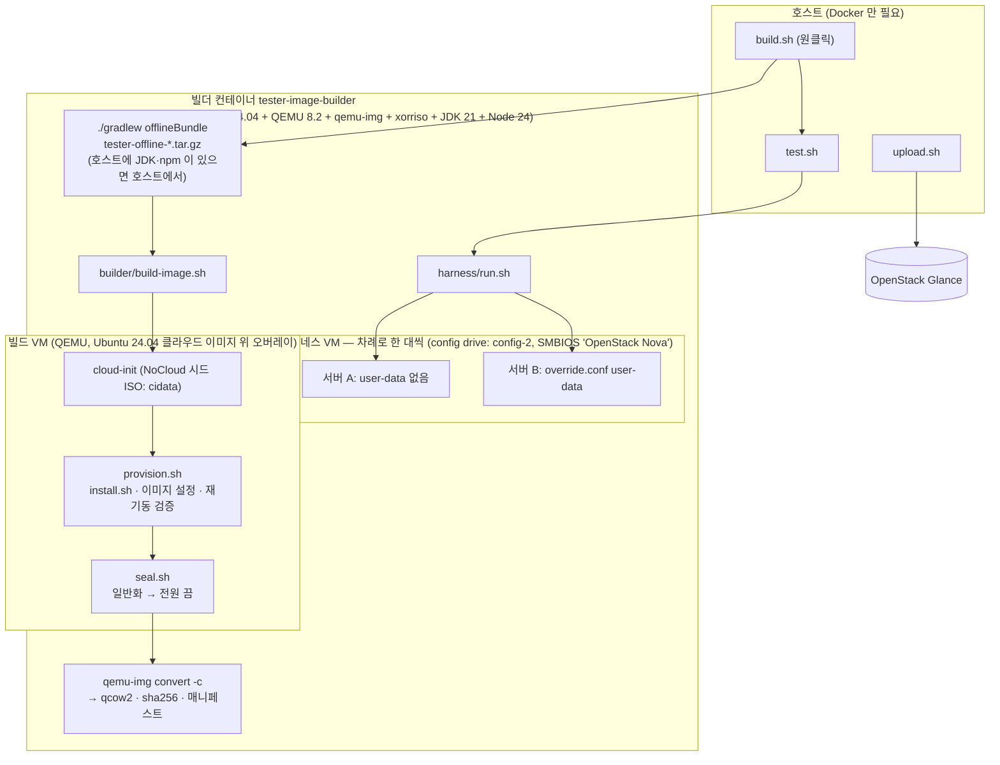
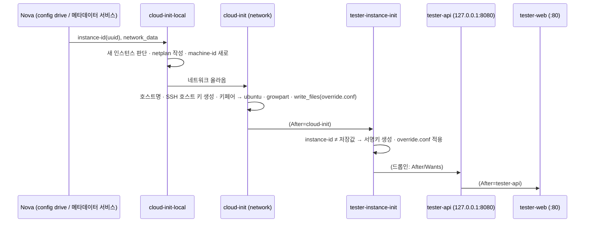

# OpenStack 이미지 (Ubuntu 24.04 qcow2) — 작업 설계 · 사용법

- 문서 버전: v1.1
- 작성일: 2026-11-11 (갱신: 2026-11-12 — Docker 만 있는 호스트, 대시보드로 올리기, 정리 스크립트)
- 대상: 테스트 도구를 OpenStack 인스턴스로 띄우기 위한 **qcow2 이미지 빌드 파이프라인**과 **검증 하네스**
- 관련 파일: `deploy/openstack/` 전체, `deploy/offline/install.sh`(`TESTER_START_TIMEOUT`)
- 상위 문서: [design.md](design.md) — 애플리케이션 자체의 설계. 운영 관점 사용법의 1차 출처는 README.md 다.

---

## 0. 빠른 시작

호스트에는 **Docker 만** 있으면 된다(예: Ubuntu 24.04 + Docker). QEMU·qemu-img·xorriso, 설치본을 만들 JDK 21·Node 24 가
모두 빌더 컨테이너에 들어 있다. 저장소를 받고(`git clone`) 스크립트 하나를 실행한다.

```bash
./deploy/openstack/build.sh          # 원클릭: 빌더 이미지 → 설치본 → qcow2 → 하네스 검증
# → build/openstack/tester-<버전>-ubuntu-24.04-amd64.qcow2, 끝에 대시보드 입력값을 보여 준다
./deploy/openstack/clean.sh          # 끝나면 검증 보고서·캐시·빌더 이미지 정리 (qcow2 는 남김)
```

올리기와 서버 만들기는 대시보드(Horizon)에서 한다 — §5.4. CLI 를 쓰려면 `./deploy/openstack/upload.sh`.

> **`./gradlew openstackImage` 는 Docker 만 있는 호스트에서는 돌지 않는다.** Gradle 자체가 실행되려면 호스트에 Java 가 필요하다.
> Docker 만 있으면 `build.sh` 를 쓴다 — 호스트에 JDK·npm 이 있으면 호스트에서, 없으면 빌더 컨테이너 안에서 설치본을 만든다
> (`--bundle-in-docker` 로 강제).
>
> Gradle 명령으로 부르고 싶으면 Ubuntu 24.04 에 JDK 21 과 Node 22+ 를 설치한다(apt 의 nodejs 는 18 이라 nodejs.org 배포본):
>
> ```bash
> sudo apt install -y openjdk-21-jdk-headless curl xz-utils
> curl -fsSL https://nodejs.org/dist/v24.22.1/node-v24.22.1-linux-x64.tar.xz \
>   | sudo tar -xJ -C /usr/local --strip-components=1 --exclude='*.md' --exclude=LICENSE
> ./gradlew openstackImage                       # = 호스트에서 offlineBundle → build.sh --skip-bundle
> ./gradlew openstackImage -PimageArgs=--no-test # 검증 생략 등 build.sh 옵션은 -PimageArgs 로
> ```

| 호스트에 필요한 것 | |
|---|---|
| Docker (데몬 실행 중, 현재 사용자가 쓸 수 있음 — `docker` 그룹 또는 sudo) | 필수 |
| bash, coreutils, git(저장소 받기·커밋 기록) | Ubuntu 기본 |
| 인터넷 — Docker Hub(ubuntu:24.04), Ubuntu apt, nodejs.org, Maven Central·npm·Gradle 배포본, Adoptium·nodejs.org(설치본용 JRE·Node), cloud-images.ubuntu.com | 처음 빌드 때. 폐쇄망은 §7 |
| 디스크 약 8GB(저장소 쪽 결과물·캐시 약 3GB + Docker 쪽 빌더 이미지·작업 디스크 약 5GB) | 끝나면 `clean.sh` |
| **메모리 여유 약 3GB** — 빌드 VM 2GB(`--memory`) + QEMU, 검증은 서버 한 대씩 2GB. 호스트에 JDK 가 있어 설치본을 호스트 Gradle 로 만들면 Gradle 데몬 약 0.6GB 가 빌드 내내 더 남는다 | 같은 Docker 에서 메모리를 많이 쓰는 서비스가 돌고 있으면 그쪽이 메모리 부족으로 죽을 수 있다(§10) — 빌드 전용 장비 권장 |
| `/dev/kvm`(있으면 자동 사용 — 빠르다) | 선택 |

| 결과물 (`build/openstack/`) | 내용 |
|---|---|
| `tester-<버전>-ubuntu-24.04-amd64.qcow2` | OpenStack 에 올릴 이미지 (압축 qcow2, 가상 8GiB) |
| `….qcow2.sha256` | 체크섬 (`sha256sum -c` 형식) |
| `….json` | 매니페스트 — Glance 권장 속성·최소 디스크/메모리·베이스 이미지 serial·빌드 정보 |
| `….build-console.log` | 빌드 VM 시리얼 콘솔 전체 (실패 원인 추적용) |
| `harness/<이름>/report.txt`, `junit.xml`, `console-*.log` | 하네스 검증 결과 |

> macOS(Apple Silicon)의 Docker Desktop 에는 `/dev/kvm` 이 없어 QEMU 가 **소프트웨어 에뮬레이션(TCG)** 으로
> 돈다. 결과물은 같지만 원클릭 전체(빌드 18~21분 + 검증 19~20분)가 약 39분 걸렸다(§9). 리눅스 x86_64 + KVM 호스트에서는 훨씬 빠를 것이다(몇 분 예상,
> 측정 안 함) — `build.sh` 가 `/dev/kvm` 이 있으면 자동으로 컨테이너에 넘긴다.

---

## 1. 목표 / 비목표

| # | 목표 | 수용 기준 |
|---|---|---|
| G1 | 호스트에는 Docker 만 | 설치본 빌드(JDK·Node)·이미지 빌드(QEMU)·검증 도구가 전부 빌더 컨테이너 안 |
| G2 | 원클릭 | `build.sh` 한 번으로 설치본 → 이미지 → 검증까지. 실패하면 0 이 아닌 종료 코드 |
| G3 | 설치 경로 하나 | 이미지 안 설치도 **기존 오프라인 설치본의 `install.sh` 그대로**. 이미지 전용 설치 로직을 따로 두지 않는다 |
| G4 | 인스턴스마다 달라야 하는 것은 이미지에 없다 | 로그인 서명키·SSH 호스트 키·machine-id·cloud-init 상태·빌드 VM 네트워크 설정이 서버마다 새로 생긴다 |
| G5 | OpenStack 표준 동작 | cloud-init(메타데이터/config drive), 키페어 로그인, 루트 디스크 자동 확장, user-data 로 인스턴스별 설정 |
| G6 | 폐쇄망 빌드 | 베이스 이미지 캐시·로컬 파일·내부 미러, 빌드 VM 네트워크 차단(`--offline`), 빌더 이미지 반입 |
| G7 | 검증 자동화 | 만든 이미지를 OpenStack 과 같은 모양으로 띄워 점검. 사람이 읽는 보고서 + JUnit XML |

**비목표**
- Packer · diskimage-builder · virt-customize(libguestfs) 사용 — 이유는 §8 D1.
- OpenStack 에 서버를 자동으로 배포·운영하는 것. 이 작업은 **이미지와 그 업로드까지**다(`upload.sh`).
- 실제 OpenStack 클라우드를 상대로 한 자동 검증. 하네스는 QEMU 로 Nova 를 흉내 낸다 — 실 클라우드에서는 §6.4 체크리스트로 확인한다.

---

## 2. 전체 구조



흐름은 세 덩어리다.

1. **빌드** (`build.sh` → 컨테이너 안 `./gradlew offlineBundle` 과 `builder/build-image.sh`): 오프라인 설치본을 만들고(호스트에 JDK·npm 이
   있으면 호스트에서), 클라우드 이미지 위에 오버레이 디스크를 만들고, 설치본을 담은
   시드 ISO 와 함께 QEMU 로 부팅한다. 빌드 VM 안에서 cloud-init 이 `provision.sh` 를 실행해 설치·설정·검증을 하고,
   `seal.sh` 가 일반화한 뒤 스스로 전원을 끈다. 빌더는 오버레이를 펼쳐 압축 qcow2 로 만든다.
2. **검증** (`test.sh` → 컨테이너 안 `harness/run.sh`): 결과 qcow2 를 OpenStack 이 띄우는 모양(오버레이 디스크 + config drive +
   Nova SMBIOS)으로 한 대씩 차례로 두 대 띄워 41개 항목을 점검한다.
3. **사용**: 대시보드(Horizon)에서 매니페스트의 권장 값으로 이미지를 만들고(§5.4) 서버를 띄운다. CLI 면 `upload.sh`.

---

## 3. 파일 구성

| 파일 | 어디서 | 역할 |
|---|---|---|
| `deploy/openstack/build.sh` | 호스트 | 원클릭. 빌더 이미지 → 설치본(호스트 또는 컨테이너) → 이미지 빌드 → 하네스 → 대시보드 입력값 출력 |
| `deploy/openstack/clean.sh` | 호스트 | 정리: 검증 보고서·빌드 로그·베이스 이미지 캐시·컨테이너 Gradle 캐시·빌더 이미지(`--all` 이면 qcow2 까지, `--dry-run`) |
| `deploy/openstack/test.sh` | 호스트 | 하네스만 실행 (기본: 가장 최근 이미지) |
| `deploy/openstack/upload.sh` | 호스트 | Glance 업로드 + 권장 속성. 호스트에 CLI 가 없으면 컨테이너의 `openstack` 사용 |
| `deploy/openstack/lib/host.sh` | 호스트 | Docker 확인, 빌더 이미지 빌드, `docker run` 공통 인자(마운트·KVM·UID), 컨테이너 안 Gradle |
| `deploy/openstack/docker/Dockerfile` | — | 빌더 이미지(약 1.3GB). QEMU(x86·arm)·UEFI 펌웨어·qemu-img·xorriso·ssh·jq·python3·openstackclient·JDK 21·Node 24 |
| `deploy/openstack/builder/build-image.sh` | 컨테이너 | 베이스 확보 → 오버레이 → 시드 ISO → 빌드 VM → 압축·체크섬·매니페스트 |
| `deploy/openstack/lib/common.sh` | 컨테이너 | QEMU 인자(아키텍처·KVM/TCG), ISO 생성, 콘솔 따라 보기 |
| `deploy/openstack/guest/provision.sh` | 빌드 VM | 패키지 → `install.sh` → 이미지 설정 → 재기동 검증 → seal 예약 |
| `deploy/openstack/guest/seal.sh` | 빌드 VM | 일반화(§4.5) 후 전원 끔 |
| `deploy/openstack/guest/tester-instance-init` (+ `.service`, `10-instance-init.conf`) | 이미지 | 매 부팅: 새 인스턴스면 서명키 생성, `/etc/tester/override.conf` 적용 |
| `deploy/openstack/guest/90-tester.conf` | 이미지 | 커널 파라미터(소켓 버퍼) |
| `deploy/openstack/guest/override.conf.example` | 이미지 | `/etc/tester/override.conf.example` — 인스턴스별 설정 안내 |
| `deploy/openstack/harness/run.sh` | 컨테이너 | 하네스 본체 |
| `deploy/openstack/harness/sink.py` | 하네스 VM | E2E 전송 확인용 TCP 수신기(줄 수 세기) |

스크립트는 빌더 이미지에 굽지 않고 실행할 때 `deploy/openstack` 을 읽기 전용으로 마운트한다(`/opt/tester-image`).
스크립트를 고쳐도 빌더 이미지를 다시 만들 필요가 없고, 빌더 이미지는 도구 묶음으로만 남는다.

| 컨테이너 마운트 | 호스트 | 용도 |
|---|---|---|
| `/opt/tester-image` (ro) | `deploy/openstack` | 스크립트 |
| `/in` (ro) | 설치본이 있는 디렉터리 | 오프라인 설치본 |
| `/out` | `build/openstack` | 결과물·보고서 |
| `/cache` | `.runtime-cache/openstack` | 베이스 클라우드 이미지 캐시(`clean` 해도 남는다, 이미 `.gitignore`) |
| `/work` | (컨테이너 내부) | 오버레이 디스크·시드 ISO — macOS 바인드 마운트는 임의 I/O 가 느려 컨테이너 안에 둔다 |

설치본을 컨테이너에서 만들 때(`run_gradle_in_builder`)는 저장소를 **호스트와 같은 절대 경로**로 붙이고 **호스트 사용자 UID** 로 돈다 —
`build/`·`node_modules` 가 root 소유로 남지 않고, Gradle 이 기록하는 경로도 호스트와 같다. Gradle·npm 캐시는
`.runtime-cache/gradle-docker` 에 둔다(다음 빌드가 빨라지고, `clean.sh` 가 지운다). 사내 미러는 환경변수(`TESTER_REPO_URL`,
`NPM_REGISTRY`, `TESTER_JRE_URL`, `TESTER_NODE_URL`, `TESTER_GRADLE_DIST_URL`)로 넘기거나 `gradle.properties` 에 적는다.

---

## 4. 빌드 단계 상세

### 4.1 베이스 이미지

- 출처: `https://cloud-images.ubuntu.com/releases/noble/release/ubuntu-24.04-server-cloudimg-<arch>.img`
  (`--base-serial 20261017` 이면 `release-20261017/` — 재현 빌드용 고정).
- 같은 디렉터리의 `SHA256SUMS` 와 대조하고, `unpacked/build-info.txt` 의 `serial` 을 읽어 매니페스트와
  이미지 안 `/etc/tester-image-release` 에 남긴다. 캐시 파일 이름도 serial 을 담는다
  (`.runtime-cache/openstack/noble-<serial>-ubuntu-24.04-server-cloudimg-amd64.img`). `release` 가 새 serial 로
  넘어가면 해시가 달라져 새로 받는다.
- 인터넷이 안 되면: 캐시의 가장 최근 파일 → 캐시에 직접 넣은 `ubuntu-24.04-server-cloudimg-<arch>.img` 순으로 쓰고
  "대조 없이 사용" 경고를 남긴다. `--base-image FILE` 로 파일을 직접 줄 수도, `--base-url-root` 로 내부 미러를 줄 수도 있다.
- 받은 파일이 qcow2 인지 `qemu-img info` 로 확인한다.

### 4.2 작업 디스크

베이스를 백킹 파일로 하는 **qcow2 오버레이**를 `--disk-size`(기본 8G)로 만든다. 베이스(가상 3.5GiB)를 복사해 키우는
대신 오버레이를 쓰는 이유는 빠르고, 마지막 `qemu-img convert` 가 어차피 하나의 독립 이미지로 펼치기 때문이다.
빌드 VM 첫 부팅에서 cloud-init growpart 가 파티션을 8GiB 로 늘린다. 이 크기가 곧 이미지의 **최소 디스크(min_disk)** 다 —
플레이버 디스크가 이보다 작으면 Nova 가 거부한다. 더 큰 디스크로 띄우면 인스턴스 첫 부팅에서 다시 늘어난다.

### 4.3 시드 ISO (cloud-init NoCloud)

라벨 `cidata` 인 ISO 하나에 모두 담는다.

```
seed.iso
├── meta-data           instance-id: tester-image-build
├── user-data           users: [] · runcmd: cidata 를 마운트하고 provision.sh 실행
└── payload/
    ├── build.env       이미지 이름·버전·serial·시간대·패키지·apt 미러·기동 대기 시간 (printf %q 로 안전하게)
    ├── tester-offline-<버전>-linux-x64.tar.gz
    └── guest/          provision.sh, seal.sh, tester-instance-init(+유닛), 90-tester.conf, override.conf.example
```

- `users: []` — 빌드 VM 에는 **로그인 계정을 만들지 않는다.** SSH 로 들어가 프로비저닝하지 않으므로 필요 없고,
  키나 계정 흔적이 이미지에 남을 여지도 없다. 기본 계정 `ubuntu` 는 OpenStack 인스턴스 첫 부팅 때 cloud-init 이 만든다.
- 설치본은 ISO 에서 바로 읽어 푼다(디스크로 복사하지 않음 — 이미지에 남지 않는다).

### 4.4 빌드 VM 안 — `provision.sh`

cloud-init 의 `runcmd` 가 한 번 실행한다. 모든 출력은 시리얼 콘솔(`/dev/console`)로 간다.

1. **추가 패키지** — 기본 `qemu-guest-agent`(OpenStack 의 `hw_qemu_guest_agent=yes` 와 짝). `--apt-mirror` 가 있으면
   빌드 중에만 `ubuntu.sources` 를 바꿨다 되돌린다. 첫 부팅의 apt-daily 잠금은 `DPkg::Lock::Timeout` 으로 기다린다.
   `--offline` 이면 이 단계를 건너뛴다.
2. **테스트 도구 설치** — 설치본을 풀고 `install.sh` 를 **그대로** 실행한다. 서버에 직접 설치할 때와 같은 8단계
   (계정·JRE·Node·앱·설정·systemd·기동 확인)가 돈다. 에뮬레이션에서는 백엔드 기동이 수 분 걸리므로
   `TESTER_START_TIMEOUT`(이번에 `install.sh` 에 추가, 기본 180초 그대로)을 늘려 넘긴다.
3. **이미지 설정**
   - `JAVA_OPTS="-Xms256m -XX:MaxRAMPercentage=50"` — 고정 `-Xmx2g` 대신 VM 메모리 비율(§8 D7).
   - 시간대(기본 `Asia/Seoul` — Docker 배포가 `TZ=Asia/Seoul` 을 기본으로 둔 것과 같은 이유: UTC 면 로그 시각이 9시간 어긋난다).
   - `/etc/sysctl.d/90-tester.conf` — README "운영 시 주의"의 소켓 버퍼 권장값.
   - `tester-instance-init` 서비스와 `tester-api`/`tester-web` 드롭인(§5.2).
   - `/etc/tester-image-release` — 이미지 이름·앱 버전·베이스 serial·빌드 시각·git 커밋.
4. **재기동 검증** — `tester-instance-init → tester-api → tester-web` 를 다시 띄워 백엔드 `/actuator/health`·화면 `/health`·화면 경유
   `/actuator/health` 가 모두 응답하는지 HTTP 로 본다(§8 D12 — `testerctl status` 는 기록용). 드롭인의 순서가 실제로 맞물리는지
   이미지 안에서 확인하는 단계다.
5. **seal 예약** — `systemd-run` 으로 `seal.sh` 를 별도 유닛으로 띄우고 끝난다(§8 D4).

### 4.5 일반화 — `seal.sh`

`cloud-init status --wait` 로 cloud-init 이 완전히 끝나기를 기다린 뒤(오류면 실패, 복구 가능한 경고면 기록하고 계속) 아래를 지운다.

| 지우는 것 | 왜 / 누가 다시 만드나 |
|---|---|
| `TESTER_JWT_SECRET` 값, `conf/instance-id` | 서버들이 키를 공유하면 한 서버의 로그인 토큰이 다른 서버에서도 통한다 → 첫 부팅 때 `tester-instance-init` |
| `/opt/tester/data`·`logs`·`run` 내용 | 검증 기동 때 생긴 H2 DB·로그 → 첫 기동 때 앱이 새로 만든다 |
| `/etc/ssh/ssh_host_*` | 서버마다 달라야 한다 → cloud-init(ssh 모듈) |
| `/etc/netplan/50-cloud-init.yaml` | 빌드 VM 의 MAC 에 묶여 있다 → cloud-init 이 인스턴스 NIC·network_data 로 새로 쓴다 |
| `cloud-init clean --logs --seed --machine-id` | cloud-init 이 다음 부팅을 "새 인스턴스"로 보게 하고, machine-id 를 `uninitialized` 로 → systemd 가 첫 부팅에 새로 만든다 |
| `/var/lib/systemd/random-seed` | 서버들이 같은 난수 시드로 시작하지 않게 |
| 빌드 로그, `/var/log` 회전 파일·내용, 저널, apt 캐시·목록, `/tmp`, root history | 흔적 제거·크기 축소 (apt 는 인스턴스에서 `apt update` 후 사용) |

마지막으로 `fstrim -av` — 빌더가 디스크를 `discard=unmap` 으로 붙였으므로 지운 블록이 오버레이에서 빠지고,
`qemu-img convert` 가 그 자리를 건너뛴다(§8 D8). 그다음 `TESTER-IMAGE-RESULT: OK` 를 콘솔에 남기고 전원을 끈다.

### 4.6 압축 · 체크섬 · 매니페스트

- `qemu-img convert -O qcow2 -c -o compat=1.1` — 오버레이를 펼친 독립 이미지, zlib 압축(§8 D9). `qemu-img check` 통과 후 이름을 바꾼다
  (중간 산출물은 `.part` — 실패하면 지운다).
- `….qcow2.sha256` 과 `….json` 매니페스트(Glance 속성·min_disk/min_ram·베이스 URL/serial/SHA256·빌드 시간·가속 방식·QEMU 버전).
  `upload.sh` 와 하네스가 이 매니페스트를 읽는다.

### 4.7 빌더 ↔ 빌드 VM 신호

SSH 없이 **시리얼 콘솔 한 줄**로 주고받는다.

- 게스트 스크립트는 진행 상황을 `[tester-image] …` 로 콘솔에 쓴다. 빌더는 콘솔 파일을 따라가며 이 줄과
  `Cloud-init v. … running/finished` 줄만 골라 터미널에 보여 준다(`follow_console`).
- 성공은 `TESTER-IMAGE-RESULT: OK`(seal 끝), 실패는 `TESTER-IMAGE-RESULT: FAIL <이유>`(provision/seal 의 ERR 트랩 —
  몇 번째 줄 어떤 명령인지 담는다) 후 **즉시 전원을 끈다** — 빌더가 제한 시간까지 기다리지 않는다.
- 결과 줄 없이 꺼지거나 제한 시간(`--timeout`, 기본 KVM 20분·TCG 90분)을 넘기면 실패. 어느 경우든 콘솔 마지막 60줄을
  보여 주고 전체를 `….build-console.log` 로 남긴다.
- QEMU 는 `-no-reboot` 로 띄운다 — 빌드 VM 이 어떤 이유로 재부팅하려 하면 그대로 끝나 실패로 잡힌다.

### 4.8 QEMU 구성

| | amd64 | arm64 |
|---|---|---|
| 머신 | `q35`, SeaBIOS | `virt`, UEFI(`qemu-efi-aarch64`) |
| 가속 | 컨테이너에 `/dev/kvm` 이 있고 호스트도 x86_64 → `kvm -cpu host`, 아니면 `tcg,thread=multi -cpu max` | 같은 규칙(aarch64 호스트) |
| 디스크 | virtio-blk, `discard=unmap,detect-zeroes=unmap,cache=unsafe`(빌드만 — 정상 종료 때만 결과를 쓰므로) | 같음 |
| 시드/config drive | 읽기 전용 virtio 디스크(ISO9660) — cloud-init 은 장치 종류가 아니라 파일시스템 라벨로 찾는다 | 같음 |
| 네트워크 | user(slirp) + virtio-net, `romfile=`(iPXE ROM 불필요). `--offline` 이면 `restrict=on` | 같음 |
| 기타 | `-nodefaults -display none`, virtio-rng(엔트로피 — 첫 부팅 키 생성이 빨라진다) | 같음 |

---

## 5. 이미지 런타임 — OpenStack 에서 어떻게 동작하나

### 5.1 인스턴스 첫 부팅 순서



### 5.2 인스턴스 초기화 (`tester-instance-init`)

매 부팅 `tester-api`·`tester-web` 보다 먼저 도는 oneshot 서비스(`RemainAfterExit`).

1. **서명키** — cloud-init 의 instance-id(`/var/lib/cloud/data/instance-id`, OpenStack 에서는 서버 UUID)가
   `/opt/tester/conf/instance-id` 와 다르거나 서명키가 비어 있으면 새로 만든다. 그래서
   - 이미지로 만든 서버마다 다른 키를 받는다.
   - **스냅샷으로 복제한 서버**도 UUID 가 달라 새 키를 받는다 — 데이터(템플릿·대상·작업)는 그대로, 로그인만 다시.
   - 같은 서버를 재부팅하면 키가 유지된다(로그인 유지).
2. **`/etc/tester/override.conf`** — 있으면 `KEY=VALUE` 를 `tester.conf` 에 덮어쓴다(매 부팅, 값은 따옴표 포함 그대로,
   키는 `^[A-Z][A-Z0-9_]*$` 만). override 에 `TESTER_JWT_SECRET` 을 적으면 그 값이 이긴다(여러 대가 같은 키를 써야 할 때).
   로그에는 키 이름만 남기고 값은 남기지 않는다.

`tester-api`·`tester-web` 에는 드롭인(`/etc/systemd/system/<유닛>.service.d/10-instance-init.conf`: `Wants=`+`After=`)으로
걸었다. `install.sh` 로 업그레이드하면 서비스 파일은 다시 쓰이지만 드롭인은 남는다.

### 5.3 이미지 기본값

| 항목 | 값 | 바꾸는 법 |
|---|---|---|
| 화면 포트 | 80 (0.0.0.0) | override `TESTER_WEB_PORT` |
| 백엔드 | 127.0.0.1:8080 — 외부에 열지 않는다 | override `TESTER_API_BIND` (권장하지 않음) |
| JVM | `-Xms256m -XX:MaxRAMPercentage=50` | override `JAVA_OPTS` |
| 로그인 서명키 | 인스턴스마다 생성 | override `TESTER_JWT_SECRET` |
| DB | H2 파일 `/opt/tester/data` (AUTO_SERVER 없음 — design.md §16.19) | — |
| 시간대 | Asia/Seoul (빌드 옵션 `--timezone`) | user-data `timezone: UTC` |
| 커널 | `net.core.wmem_max`/`rmem_max` = 16MiB | `/etc/sysctl.d/` |
| 게스트 에이전트 | qemu-guest-agent (빌드 옵션 `--packages`, `--offline` 이면 없음) | — |
| 로그인 | `ubuntu` + 키페어(SSH 비밀번호 로그인 꺼짐 — 클라우드 이미지 기본) | user-data |

관리 명령은 오프라인 설치와 같다: `testerctl status` · `testerctl logs [api|web]` · `sudo testerctl restart`.

### 5.4 OpenStack 에서 쓰기

#### 올릴 때 넣는 값

`build.sh` 가 끝날 때 매니페스트(`….json`)에서 읽어 그대로 보여 준다.

| 항목 | 값 | 필요 | 이유 |
|---|---|---|---|
| 디스크 포맷 / 컨테이너 | `QCOW2` / `bare` | 필수 | |
| 최소 디스크 / 최소 RAM | 8 GB / 2048 MB | 권장 | 가상 디스크 크기 / JVM+Node 최소. 넣어 두면 작은 플레이버로 띄우는 실수를 막는다 |
| `architecture` | `x86_64` (arm64 이미지는 `aarch64`) | 권장 | 아키텍처가 다른 compute 에 스케줄되지 않게 |
| `hw_qemu_guest_agent` | `yes` | 권장 | 이미지에 qemu-guest-agent 가 들어 있다. Nova 가 에이전트 채널을 붙인다(스냅샷 quiesce 등). 없어도 부팅에는 영향 없음 |
| `os_distro`, `os_version`, `os_type` | `ubuntu`, `24.04`, `linux` | 권장 | 대시보드 표시·스케줄러 필터 |
| `os_admin_user` | `ubuntu` | 선택 | 로그인 계정 안내 |
| `hw_disk_bus`, `hw_vif_model` | `virtio` | 선택 | 기본값과 같다 |
| `hw_firmware_type` | `uefi` | arm64 만 | |
| `tester_version`, `tester_base_serial` | 앱 버전, 베이스 serial | 선택 | 어떤 빌드인지 추적 |

#### 대시보드(Horizon)로 올리기

1. 올리기 전에 파일이 온전한지 확인한다(다른 장비로 옮겼다면 특히): `sha256sum -c tester-…qcow2.sha256`
2. **프로젝트 → 컴퓨트 → 이미지 → 이미지 생성**
   - 이미지 세부 정보: 이름, 파일(`….qcow2`), 포맷 **QCOW2 - QEMU 에뮬레이터**
   - 이미지 요구 사항: 아키텍처 `x86_64`, 최소 디스크 `8`, 최소 RAM `2048`
   - 공유: 공개 여부·보호(삭제 방지)는 필요에 따라
   - 메타데이터: "사용자 지정" 칸에 키를 적고 **+** 로 추가한 뒤 값을 넣는다 — 위 표의 `hw_qemu_guest_agent=yes`, `os_distro=ubuntu`,
     `os_version=24.04`, `os_type=linux` 정도면 된다
3. 목록에서 상태가 **활성(Active)** 이 되고 크기가 파일과 같은지 본다.

약 900MB 를 브라우저로 올린다. 클라우드 설정(`HORIZON_IMAGES_UPLOAD_MODE`, 앞단 프록시의 본문 크기 제한)에 따라 큰 파일 업로드가 막혀
있거나 중간에 끊길 수 있다 — 그때는 CLI(`upload.sh`, 아래)로 올리거나 클라우드 관리자에게 요청한다. Glance 는 자체 해시(`os_hash_value`,
보통 sha512)를 계산하므로 `.sha256` 과 숫자가 다른 것은 정상이다.

#### 대시보드로 인스턴스 시작

**프로젝트 → 컴퓨트 → 인스턴스 → 인스턴스 시작**

| 단계 | 넣을 것 |
|---|---|
| 세부 정보 | 인스턴스 이름 — 그대로 호스트명이 된다 |
| 소스 | 부팅 소스 "이미지" → 이 이미지. "새 볼륨 생성 = 예"(볼륨 부팅)여도 된다 — 볼륨 크기를 **8GB 이상**으로. 첫 부팅에 루트가 디스크(볼륨) 크기만큼 늘어난다 |
| Flavor | vCPU 2 / RAM 4GB / 디스크 20GB 이상 권장(최소 RAM 2GB · 디스크 8GB). 10만 EPS 급이면 vCPU 를 늘린다(전송 워커 상한이 코어 수 — design.md §8) |
| 네트워크 | 전송 대상(수집 서버)에 닿는 네트워크 |
| 보안 그룹 | 인바운드 TCP 22(SSH), TCP 80(화면). 8080 은 열지 않는다(백엔드는 서버 안에서만 열린다) |
| 키 페어 | **필수** — 이미지에 비밀번호가 없다(SSH 는 `ubuntu` + 키) |
| 구성 | "사용자 정의 스크립트"에 아래 user-data(선택). "구성 드라이브"는 메타데이터 서비스가 없는 클라우드에서만 켜면 된다 |

시작한 뒤 필요한 네트워크면 유동 IP 를 연결하고 `http://<IP>` 로 접속한다(처음 부팅은 1~2분). 안 열리면 SSH 로 들어가
`cloud-init status --long`, `testerctl status`, `testerctl logs` 를 본다.

**이 도구는 비밀번호 없이 아이디만으로 로그인한다** — 보안 그룹에서 화면 포트(80)는 반드시 내부 대역으로만 연다.
아웃바운드는 전송 대상의 포트로 열려 있어야 한다(기본 보안 그룹은 전체 허용).

#### 사용자 정의 스크립트(user-data) 예

필요한 것만 골라 넣는다. 모두 선택이다.

```yaml
#cloud-config
# 인스턴스별 설정 — 화면 포트·JVM 옵션 (매 부팅 tester.conf 에 덮어쓴다, §5.2)
write_files:
  - path: /etc/tester/override.conf
    content: |
      TESTER_WEB_PORT=8000
      JAVA_OPTS="-Xms1g -XX:MaxRAMPercentage=70"

# 시간대 — 이미지 기본은 Asia/Seoul
timezone: Asia/Seoul

# 시간 동기화 — 만드는 로그의 시각(${ts})이 서버 시계를 따른다. 기본 NTP(ntp.ubuntu.com)에 닿지 않는 폐쇄망이면 내부 NTP 를 준다
ntp:
  enabled: true
  servers: [ntp.example.internal]

# 대시보드 "콘솔" 탭으로 로그인해야 할 때만 — 이미지에는 비밀번호가 없다. SSH 비밀번호 로그인은 꺼진 그대로다.
# user-data 는 인스턴스 안에서 메타데이터로 다시 읽을 수 있으니 임시 비밀번호로 쓰고 바꾼다(passwd).
chpasswd:
  expire: false
  users:
    - {name: ubuntu, password: "임시-비밀번호", type: text}
```

#### CLI 로 올리고 띄우기 (선택)

```bash
source ~/project-openrc.sh            # 또는 export OS_CLOUD=mycloud
./deploy/openstack/upload.sh          # 위 표의 값을 붙여 올린다. --dry-run 으로 명령만 확인, --name, --visibility
openstack server create tester-01 --image <이미지> --flavor <플레이버> \
  --network <네트워크> --key-name <키페어> --security-group <보안그룹> \
  [--user-data user-data.yaml] [--config-drive true]
```

호스트에 `openstack` CLI 가 없으면 `upload.sh` 가 빌더 컨테이너 안의 CLI 를 쓴다(OS_* 환경변수와 `~/.config/openstack/clouds.yaml` 을 넘긴다).

**업그레이드** — 두 가지다.
- 새 이미지로 서버를 다시 만든다(권장 — 이미지가 곧 버전). 데이터를 옮기려면 `/opt/tester/data` 를 볼륨에 두거나 복사한다.
- 기존 서버에서 새 오프라인 설치본으로 `sudo ./install.sh` — 오프라인 설치와 같은 업그레이드 경로(설정·데이터 유지,
  드롭인 유지).

---

## 6. 하네스

### 6.1 OpenStack 흉내

실제 클라우드 없이 Nova 가 띄우는 모양을 QEMU 로 재현한다.

| Nova | 하네스 |
|---|---|
| 이미지 위 인스턴스 디스크(copy-on-write) | 결과 qcow2 위 12G 오버레이 — 이미지보다 커서 growpart 확인 |
| config drive (`config_drive=true`) | 라벨 `config-2` ISO: `openstack/latest/meta_data.json`(uuid·hostname·public_keys) · `network_data.json`(MAC·ipv4_dhcp) · `user_data` · `vendor_data*.json` |
| 키페어 | 하네스가 만든 ed25519 키를 `public_keys` 로 → `ubuntu` 로 SSH |
| SMBIOS | `manufacturer=OpenStack Foundation, product=OpenStack Nova, serial/uuid=<uuid>` — cloud-init ds-identify 가 OpenStack 으로 판단 |
| virtio 디스크·NIC, guest agent 채널 | 같음 (`org.qemu.guest_agent.0` 소켓) |
| 보안 그룹 | 포트 포워딩(SSH, 화면)만 연다 |

서버 두 대를 **차례로** 띄운다. **A** 는 user-data 없이(가장 흔한 사용) 기본 동작·E2E 전송을 보고 재부팅까지 한 뒤,
서명키·machine-id·SSH 호스트 키·로그인 토큰을 기록하고 끈다. **B** 는 `override.conf`(화면 포트 8088, `MaxRAMPercentage=40`)를
user-data 로 넣어 띄우고, 기록해 둔 A 의 값과 비교한다. 동시에 띄우지 않는 이유는 메모리다 — Docker Desktop 처럼 작은 VM 에서
다른 컨테이너와 함께 돌려도 한 대 분량(기본 2GB, `--memory`)이면 된다.

### 6.2 점검 항목

| ID | 항목 | 확인하는 것 |
|---|---|---|
| S1–S3 | 이미지 파일 | `qemu-img check`, SHA256 = 매니페스트·`.sha256`, qcow2·가상 크기 |
| A00/B00 | 부팅·SSH | config drive 의 키로 `ubuntu` 로그인 (부팅 시간 기록) |
| A01/B01 | cloud-init | `status --wait --long` 정상 종료, 오류 없음 |
| A02 | 데이터소스 | `DataSourceConfigDrive`, instance-id = 메타데이터 uuid |
| A03 | 호스트명 | 메타데이터의 hostname |
| A04 | growpart | 루트가 12G 디스크에 맞게 늘어남 |
| A05/B02 | 앱 기동 | 화면 `/health` = ok, `/actuator/health` = UP (B 는 8088) |
| A06/R05 | systemd | `is-system-running` = running (실패한 유닛 없음) |
| A07/B06 | 서비스 | instance-init·api·web 모두 enabled/active |
| A08·A09 | 화면·백엔드 | 화면 서버와 프록시 경유 백엔드 헬스 |
| A10 | 노출 범위 | 8080 은 루프백에만(`127.0.0.1:8080` 또는 Java 듀얼 스택 소켓의 `[::ffff:127.0.0.1]:8080`, `0.0.0.0`·`[::]` 는 실패), 화면 포트는 외부에 |
| A11 | 서명키 생성 | 32자 이상, `conf/instance-id` = uuid, 저널에 "새 인스턴스" |
| A12 | 일반화 | 빌드 로그·빌드 cloud-init 상태 없음, netplan 에 빌드 VM MAC 없고 인스턴스 MAC 있음(root 전용 파일이라 `sudo`, grep 의 "없음"과 "읽기 실패"를 구분), machine-id 정상, root history 없음, 일반 계정은 `ubuntu` 뿐 |
| A13 | 이미지 정보 | `/etc/tester-image-release` 버전 = 매니페스트 |
| A14·A15·A16 | 이미지 설정 | 시간대, 소켓 버퍼, JVM `MaxRAMPercentage=50` |
| A17·A18 | API | 가입·로그인, Netty epoll 네이티브 전송 |
| A19 | **E2E 전송** | 게스트 안 TCP 수신기로 EPS 200 · 제한 1000건 → COMPLETED, **보냄 = 도착**, 버림·오류 0. 건수 제한은 배치 단위로 확인해 몇 건 넘을 수 있어(앱 설계 — `LoadGeneratorLifecycleTest` 도 범위로 검사) 같은 기준(제한의 2배 이내, 1000~2000)을 쓴다 |
| A20 | 게스트 에이전트 | QGA 소켓으로 `guest-info` 응답 (`hw_qemu_guest_agent` 가 실제로 쓸모 있는지) |
| B03–B05 | override | `tester.conf` 에 반영, 8088 에서 응답, JVM 옵션 40% |
| X01–X04 | 서버끼리 | (B 가 떠 있을 때, A 는 기록값) 서명키·machine-id·SSH 호스트 키가 다름, **A 의 토큰을 B 가 401 로 거부** |
| R00–R04 | 재부팅 | (A 의 비교용 값 기록) SSH 복귀(boot_id 변경), 앱 기동, 서명키 유지("같은 인스턴스"), 재부팅 전 토큰 200 · 저장된 작업 유지 |

### 6.3 결과물 · CI

- `build/openstack/harness/<이름>/report.txt` — 항목마다 PASS/FAIL/SKIP, 근거 한 줄, 걸린 시간.
- `junit.xml` — CI(Jenkins·GitLab 등)가 그대로 읽는다. 실패가 하나라도 있으면 `test.sh`·`build.sh` 가 exit 1.
- `console-a.log`, `console-b.log` — 두 서버의 시리얼 콘솔 전체.
- 부팅이 안 되면(A00/B00 실패) 그 서버의 나머지 항목은 돌리지 않고 바로 끝낸다 — 각 항목이 제한 시간까지 기다리지 않게.
  (판단은 그 부팅 항목의 결과로만 한다 — 앞 서버에서 다른 항목이 실패했다고 멈추지 않는다.)
- 서버 한 대의 크기는 `--cpus`(기본 min(4, 코어 수))·`--memory`(기본 2048MB = 이미지 min_ram).
- CI 에서는 리눅스 x86_64 + KVM 러너를 권한다(에뮬레이션보다 훨씬 빠르다). `/dev/kvm` 은 자동으로 넘어간다
  (러너 계정이 `kvm` 그룹이어야 한다).

### 6.4 실제 OpenStack 에서 확인할 것 (수동 체크리스트)

하네스는 Nova 를 흉내 낼 뿐이다. 클라우드마다 다른 부분은 처음 한 번 직접 본다.

1. `upload.sh` 후 `openstack image show <이름>` — `status=active`, 속성이 매니페스트와 같은지.
2. config drive 없이(메타데이터 서비스 169.254.169.254) 서버를 만들어 SSH 로그인 — 하네스는 config drive 경로만 본다.
3. `cloud-init status --long` → `done`, `testerctl status` → 둘 다 정상.
4. 브라우저로 `http://<IP>` 접속·로그인, 전송 대상에 수집 서버를 넣고 짧게 전송.
5. 같은 이미지로 두 번째 서버 → 첫 서버의 로그인이 두 번째에서 통하지 않는지(로그인 화면으로 돌아감).
6. 스냅샷 → 새 서버: 데이터 유지, 다시 로그인 필요(`journalctl -u tester-instance-init` 에 "새 인스턴스").
7. (`hw_qemu_guest_agent=yes`) `openstack server show` 의 상태, 또는 compute 노드에서 `virsh qemu-agent-command <도메인> '{"execute":"guest-ping"}'`.

---

## 7. 폐쇄망 빌드

| 무엇 | 인터넷 | 폐쇄망 |
|---|---|---|
| 빌더 이미지 | `docker build`(ubuntu:24.04 + apt + nodejs.org) | 인터넷망에서 만든 것을 `docker save tester-image-builder:latest -o builder.tar` → 반입 `docker load -i builder.tar` → `TESTER_BUILDER_SKIP_BUILD=1 ./deploy/openstack/build.sh`. 직접 만들려면 `TESTER_BUILDER_UBUNTU_IMAGE=<내부 레지스트리>/ubuntu:24.04`, `TESTER_BUILDER_APT_MIRROR=http://<미러>/ubuntu` 에 Dockerfile 의 `NODE_URL` 빌드 인자 |
| 베이스 클라우드 이미지 | cloud-images.ubuntu.com 에서 받아 캐시 | `.runtime-cache/openstack/` 에 같은 이름(`ubuntu-24.04-server-cloudimg-amd64.img`)으로 넣어 두거나 `--base-image FILE`, 내부 미러면 `--base-url-root URL`(그 아래 `release/`, `SHA256SUMS`) |
| 빌드 VM 의 apt (게스트 에이전트) | archive.ubuntu.com | `--apt-mirror http://<미러>/ubuntu`(arm64 는 ubuntu-ports 미러) 또는 `--offline`(에이전트 없이, VM 네트워크 차단) |
| 오프라인 설치본 | `./gradlew offlineBundle`(호스트 또는 빌더 컨테이너. Maven·npm 의존성, JRE·Node 를 처음 한 번 받는다) | 미러를 환경변수(`TESTER_REPO_URL`·`NPM_REGISTRY`·`TESTER_GRADLE_DIST_URL`·`TESTER_JRE_URL`·`TESTER_NODE_URL`)로 — 컨테이너로 그대로 넘어간다. JRE·Node 파일을 `.runtime-cache/` 에 넣어 두는 방식도 그대로(README "내부망 오프라인 설치"). 또는 다른 곳에서 만든 설치본을 `--bundle FILE` |

`--offline` 빌드는 빌드 VM 네트워크를 `restrict=on` 으로 막는다 — 이미지 빌드가 **정말로** 바깥에 닿지 않고 끝나는지까지 보장한다
(설치본에 JRE·Node 가 다 들어 있어서 가능하다).

---

## 8. 설계 결정

**D1. Docker 안의 QEMU 로 굽는다 (Packer · diskimage-builder · virt-customize 를 쓰지 않음).**
요구가 "호스트에는 Docker 만"이다. Packer 는 QEMU 플러그인을 `packer init` 으로 인터넷에서 받아야 하고 결국 호스트(또는 컨테이너)에
QEMU 가 필요하다. diskimage-builder 는 chroot 기반이라 Docker 안에서 돌리려면 특권 모드·loop 장치가 필요하다.
virt-customize(libguestfs)도 컨테이너 안에서 도는 대신 **systemd 가 돌지 않는 환경**이라 `install.sh` 의 서비스 등록·기동·헬스체크를
할 수 없다. QEMU 로 진짜 부팅하면 특권 모드 없이(일반 컨테이너, KVM 은 있으면 장치만 넘김) 실제 서버와 같은 경로로 설치하고
그 자리에서 기동까지 검증할 수 있다. 필요한 패키지는 apt 로 다 받을 수 있어 폐쇄망 미러에도 맞는다.

**D2. 이미지 전용 설치 로직을 두지 않고 `install.sh` 를 그대로 실행한다.**
설치 방식이 둘이 되면 한쪽만 고쳐지는 일이 생긴다(design.md §0.4 습관 3). 이미지에 필요한 차이(서명키 없음·JVM 비율·시간대·
인스턴스 초기화)는 설치 **후** 덧씌우는 설정으로만 둔다. `install.sh` 에 바꾼 것은 기동 대기 시간을 환경변수로 늘릴 수 있게 한 것
하나다(`TESTER_START_TIMEOUT`, 기본 180초 그대로 — 서버 설치 동작은 같다).

**D3. 프로비저닝은 SSH 가 아니라 cloud-init NoCloud + 시리얼 콘솔로.**
SSH 로 하려면 빌드 VM 에 계정·키를 만들고 포트를 포워딩한 뒤 다시 지워야 한다. NoCloud 시드에 스크립트를 담으면 빌드 VM 에
로그인 계정 자체가 없고(`users: []`), 결과는 콘솔 한 줄로 받는다. 지울 흔적이 줄고 실패 처리도 단순하다(실패 즉시 전원 끔).

**D4. seal 은 cloud-init 이 끝난 뒤 별도 유닛으로.**
`runcmd` 안에서 `cloud-init clean` 을 하면 cloud-init 이 아직 final 단계를 마치지 않아 상태 파일을 다시 쓴다. `systemd-run` 으로
띄운 `seal.sh` 가 `cloud-init status --wait` 로 기다렸다가 지운다.

**D5. 서명키는 이미지에 넣지 않고, 기준은 instance-id.**
`install.sh` 는 설치할 때 키를 만든다 — 이미지에 그대로 두면 이 이미지로 만든 모든 서버가 같은 키를 쓴다(한 서버의 토큰이 다른 서버에서
통함). 첫 부팅 플래그 파일 대신 instance-id 를 기준으로 삼은 이유는 **스냅샷**이다. 플래그는 스냅샷에 같이 복제되지만 instance-id 는
서버마다 다르다. 앱 자체의 "비어 있으면 data/jwt-secret 에 만든다"(design.md §16.27)에 맡기지 않은 것도 같은 이유다 — 그 파일도 스냅샷에
복제된다.

**D6. 인스턴스별 설정은 `/etc/tester/override.conf` 한 곳.**
user-data 의 `runcmd` 로 `sed` 하라고 하면 서비스가 이미 뜬 뒤라 재시작이 필요하고 순서가 꼬인다. `write_files` 는 cloud-init 초기 단계에서
쓰이고 `tester-instance-init` 이 그 뒤·서비스 앞에서 적용하므로 첫 기동부터 반영된다. 매 부팅 적용하므로 나중에 파일을 고치고 재부팅해도 된다.

**D7. JVM 힙은 메모리 비율.**
플레이버마다 RAM 이 다르고 리사이즈도 된다. 고정 `-Xmx2g` 는 2GB 플레이버에서는 OOM, 32GB 에서는 낭비다. `MaxRAMPercentage=50` 은
나머지를 화면 서버(Node)·OS·소켓 버퍼에 남긴다.

**D8. 크기 줄이기는 discard + fstrim + `convert -c` (virt-sparsify 없이).**
libguestfs 없이 같은 효과를 낸다. 빌드 VM 디스크를 `discard=unmap` 으로 붙이고 seal 끝에 `fstrim` 하면 지운 블록이 오버레이에서 빠지고,
`convert` 가 펼칠 때 0 인 영역을 건너뛴다.

**D9. 압축은 zlib(기본), zstd 아님.**
qcow2 zstd 압축은 QEMU 5.1+ 가 필요하다. 오래된 compute 노드가 섞인 클라우드에서도 열리도록 기본값을 쓴다(크기 차이는 작다).

**D10. `hw_rng_model` 은 붙이지 않는다.**
virtio-rng 를 요청하는 이미지 속성은 플레이버에 `hw_rng:allowed=True` 가 없는 클라우드에서 문제가 될 수 있다. 필요한 클라우드에서만 직접 붙인다.

**D11. 하네스는 서버 두 대(차례로) + 재부팅.**
한 대만 띄워서는 "서버마다 달라야 하는 것"(D5, SSH 호스트 키, machine-id)을 확인할 수 없고, 첫 부팅만 봐서는 "유지돼야 하는 것"
(서명키·로그인·데이터)을 확인할 수 없다. B 에 override 를 넣어 user-data 경로까지 한 번에 본다. 두 대를 동시에 띄우지 않고
A 의 값을 기록해 B 와 비교한다 — 비교에 필요한 건 값이지 A 가 살아 있는 것이 아니고(토큰도 문자열이다), 최대 메모리가 절반이 된다.

**D12. 빌드 VM 안의 기동 판정은 `testerctl status` 가 아니라 HTTP 로.**
첫 빌드에서 재기동 검증이 20분 가까이 걸린 뒤 실패했다. `testerctl status` 는 확인할 때마다 JVM 을 하나 더 띄워
`--healthcheck` 로 **2초 제한**의 HTTP 요청을 보낸다 — 실제 서버에서는 충분하지만, 에뮬레이션(TCG) 빌드 VM 에서 백엔드가 JIT 중일 때는
응답이 2초를 넘기 쉬워 한 번 통과한 직후 다음 호출이 "응답 없음"이 되기도 했다. 그래서 판정은 `curl --max-time 30`(없으면 번들 Node 의
fetch)으로 백엔드 `/actuator/health`·화면 `/health`·화면 경유 `/actuator/health` 세 가지를 보고, 제한 시간은 반복 횟수가 아니라 실제 경과
시간(`SECONDS`)으로 잰다. `testerctl status` 출력은 기록용으로만 남긴다. 같은 이유로 실패하면 서비스 저널 40줄을 콘솔에 남긴다 —
빌드 VM 에는 로그인 계정이 없어(D3) 들어가 볼 수 없기 때문이다.

---

## 9. 검증 결과

2026-11-11~12, `./deploy/openstack/build.sh` 로 amd64 이미지를 만들고 하네스를 돌린 결과다(마지막 실행은 옵션 없는 원클릭 그대로 —
설치본 빌드부터 검증까지 **38분 59초, exit 0**). 같은 명령을 다른 장비에서 돌리면
시간만 달라진다.

| 항목 | 결과 |
|---|---|
| 측정 환경 | Apple Silicon Mac, Docker Desktop VM 4 vCPU · 7.7GiB(다른 컨테이너가 약 4.2GiB 사용 중) — **KVM 없음, x86_64 를 TCG 로 에뮬레이션** |
| 빌드 (2~4단계) | **17분 38초 ~ 21분 20초** — 대부분 빌드 VM(부팅 2분, qemu-guest-agent apt 수 분, `install.sh` 백엔드 기동 약 1분, 재기동 검증·seal), 압축 약 3분 |
| 결과물 | qcow2 **약 900MB**(896~923MB, zlib 압축), 가상 8GiB. fstrim 이 약 5GiB 를 돌려줬다. 베이스 serial `20261017` |
| 하네스 | **41개 통과 / 실패 0** (18분 39초, 20분 20초 — 두 번). 서버 부팅→SSH 113~143초, 앱 응답까지 추가 2~4분, 재부팅 약 2분 |
| E2E 전송 | 제한 1000건 → 보냄 = 도착(1004 / 1056 / 1020 — 실행마다 배치 경계에 따라 다름), 버림·오류 0, Netty epoll |
| 일반화 | 두 서버의 서명키·machine-id·SSH 호스트 키 모두 다름, A 의 토큰을 B 가 401 로 거부. 재부팅 후 서명키·토큰·저장된 작업 유지 |
| **Ubuntu 24.04 + JDK 21 + Node 24 에서 `./gradlew openstackImage`** | 같은 흉내 컨테이너에 apt 의 `openjdk-21-jdk-headless` 와 nodejs.org 배포본을 설치하고 실행 → 호스트 Gradle 로 `offlineBundle` 성공, `openstackImage` 가 `build.sh --skip-bundle` 로 넘겨 빌더 컨테이너·빌드 VM 의 `install.sh` 까지 진행한 것을 확인했다. **이미지 빌드를 끝까지 보지는 않고 중단했다** — 같은 Docker VM 에서 돌던 다른 서비스(elasticsearch)가 메모리 부족으로 재시작을 반복해서다(§10). 넘겨받은 뒤의 단계는 `build.sh` 와 같고, 그 경로는 위에서 세 번 끝까지 통과했다 |
| **Docker 만 있는 Ubuntu 24.04** | Ubuntu 24.04 컨테이너(Docker CLI·git 만, Java·npm 없음, 일반 사용자 UID)에서 새로 받은 저장소로 `./deploy/openstack/build.sh` → **exit 0, 41개 통과, 54분 27초**. 설치본은 자동으로 빌더 컨테이너에서 만들어졌다(처음 실행이라 Gradle·npm 의존성 다운로드 포함 — macOS 바인드 마운트라 특히 느렸다). 같은 환경에서 `./gradlew openstackImage` 는 Java 가 없어 시작하지 못함을 확인 |

리눅스 x86_64 + KVM 에서는 측정하지 않았다. 부팅·JVM 기동이 에뮬레이션보다 수십 배 빨라 빌드·검증이 각각 몇 분일 것으로 본다
(빌드 시간의 대부분이 CPU 에뮬레이션이다).

**검증 중에 고친 것** (이 문서와 스크립트에 이미 반영됨)
- 빌드 VM 재기동 판정이 `testerctl status` 의 2초 제한 때문에 에뮬레이션에서 흔들렸다 → HTTP 로 판정(§8 D12).
- 하네스가 Docker VM 메모리를 두 대 분량 요구해 다른 컨테이너와 함께 돌릴 때 스왑이 찼다 → 서버를 차례로 띄우고 A 의 값을 기록해 비교(§8 D11).
- 하네스 자체의 판정 오류 네 가지: 8080 이 `[::ffff:127.0.0.1]:8080`(Java 듀얼 스택)으로 보이는 것을 외부 노출로 오판, root 전용 netplan 을
  sudo 없이 읽어 "읽기 실패"를 "없음"으로 오판(거짓 통과), 건수 제한의 배치 단위 초과를 실패로 처리, 앞 서버의 다른 실패 때문에 다음 서버
  부팅 직후 중단. 모두 고친 뒤 41개가 통과했다.
- 콘솔 진행 표시가 `tr` 버퍼링으로 몇 분씩 늦게 보였다 → 줄 단위로 흘려보내도록.

---

## 10. 알려진 제약 · 남은 일

- **macOS 에서는 느리다.** Docker Desktop 에 KVM 이 없어 x86_64 게스트를 에뮬레이션한다(원클릭 전체 약 39분, §9).
  리눅스 x86_64 + KVM 에서는 수 분으로 예상하지만 측정하지 않았다.
- **arm64 이미지는 검증하지 않았다.** `--arch arm64`(UEFI, `qemu-efi-aarch64`, 설치본 `-PbundleArch=aarch64`) 경로는 구현돼 있지만
  이번에 빌드·하네스를 돌린 것은 amd64 뿐이다. 처음 쓸 때 `build.sh --arch arm64` 로 하네스까지 통과하는지 확인한다.
- **실제 OpenStack 자동 검증은 없다.** §6.4 체크리스트로 처음 한 번 확인한다. 하네스는 config drive 경로만 흉내 내고 메타데이터 서비스
  (169.254.169.254) 경로는 보지 않는다.
- **비밀번호 없는 로그인**은 이미지에서도 그대로다(앱 설계, design.md §7.3). 보안 그룹으로 화면 포트 접근 대역을 반드시 제한한다.
- 이미지에서 apt 목록을 지웠다 — 인스턴스에서 패키지를 설치하려면 먼저 `sudo apt update`. 폐쇄망 인스턴스에서는 unattended-upgrades 가
  저장소에 닿지 못해 조용히 실패한다(동작에는 영향 없음).
- `/opt/tester/data` 는 루트 디스크에 있다. 서버를 다시 만들어도 데이터를 남기려면 Cinder 볼륨을 붙여 그 경로에 마운트한다(자동화하지 않음).
- **메모리를 많이 쓰는 다른 컨테이너와 같은 장비에서 돌리면 그쪽이 죽을 수 있다.** 검증 중에 실제로 겪었다 — Docker Desktop VM(7.7GB, 스왑 1GB)에서
  elasticsearch(힙 약 4GB)와 함께 빌드 VM(2GB) + 호스트 Gradle 데몬(약 0.6GB)이 돌자 스왑이 차고 elasticsearch 가 30분 동안 21번 재시작했다.
  빌드를 멈추자 바로 안정됐다. 빌드 전용 장비에서 돌리거나, 큰 서비스를 잠시 멈추거나, `--memory` 를 줄인다(2048 미만은 권하지 않는다 — 이미지 min_ram).
- **HTTP 프록시만으로 인터넷에 나가는 빌드 장비는 지원하지 않는다.** 빌드 VM 의 apt 까지 프록시를 넘기지 않는다 — 미러(`--apt-mirror`,
  `--base-url-root`, 내부 레지스트리, 사내 Maven·npm)나 `--offline` 을 쓴다.
- **snap 으로 설치한 Docker** 는 `/home` 밖의 경로를 마운트하지 못한다 — 저장소를 홈 디렉터리 아래에 둔다.
- 사용자 정의 스크립트 예(§5.4)의 `ntp`·`chpasswd` 는 cloud-init 표준 모듈이고 `cloud-init schema` 로 형식을 확인했지만, 하네스에서
  부팅해 보지는 않았다(하네스는 `write_files` → override 경로만 본다).
